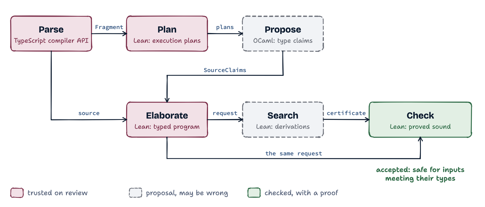

<p align="center">
  <picture>
    <source media="(prefers-color-scheme: dark)" srcset="assets/readme/lockup-dark.png">
    
  </picture>
</p>

TScert checks that TypeScript functions are type-safe, and accepts a function
only with a proof. A checker whose soundness is proved in Lean validates that
proof. It never trusts the types that TypeScript or the proposing tools infer;
what it does trust is listed under [What acceptance means](#what-acceptance-means).

https://github.com/user-attachments/assets/c539cf25-8956-4bd5-88ca-795873acab34

## Why

TypeScript's type checker is deliberately unsound in places: `any`, type
assertions, unchecked index reads and covariant arrays let programs that pass
`tsc` still read `undefined` where a type says `string`. TScert gives a stronger
answer for the code it accepts: for every input that meets its annotations, the
function's translation into a formal model never applies an operation to a value
it does not fit, and never returns a value outside its result type. A theorem in
Lean states that guarantee, and the checker that decides acceptance is the code
the theorem is about.

## An example


TypeScript accepts this function (under `strict`, which leaves
`noUncheckedIndexedAccess` off). TScert refuses it:

```ts
export function stale(xs: string[]): string {
  const n = xs.length;
  xs.pop();
  return xs[n - 1]; // past the end after the pop: undefined at run time
}
```

Abridged output (offsets refer to the example file):

```text
"status": "unverified"
reject: source expression obligation at [219,228): evidence search failed: no derivation of its return-contract claim
obligation: The available claim for xs[n - 1] is undefined | string. This return requires string.
```

With the result type stated honestly, `string | undefined`, TScert accepts it.

TypeScript's `noUncheckedIndexedAccess` refuses `stale` too, by typing every
index read `string | undefined`. It then refuses this loop as well, whose read
the condition `i < xs.length` keeps in bounds; TScert verifies it:

```ts
export function total(xs: string[]): number {
  let n = 0;
  for (let i = 0; i < xs.length; i++) n += xs[i].length; // flag: possibly 'undefined'
  return n;
}
```

TypeScript accepts the next function under every flag, since it relates arrays
covariantly. The `push` puts a number in `xs`, and under Node `toUpperCase`
throws a `TypeError`. TScert refuses the assignment, as a writable array is
invariant in its element type:

```ts
export function shout(xs: string[]): string[] {
  const ys: (string | number)[] = xs;
  ys.push(1);
  return xs.map((x) => x.toUpperCase());
}
```

Each is a pipeline case:
[`invalid-array-last-after-pop.ts`](pipeline/examples/invalid-array-last-after-pop.ts),
`afterPop` in [`array-last-element.ts`](pipeline/examples/array-last-element.ts),
[`array-index-loop.ts`](pipeline/examples/array-index-loop.ts) and
[`invalid-array-covariance.ts`](pipeline/examples/invalid-array-covariance.ts).

## How it works

<picture>
  <source media="(prefers-color-scheme: dark)" srcset="diagrams/architecture-dark.png">
  
</picture>

A front end on TypeScript's compiler API reads the source and the
declarations it uses, and Lean plans its execution. An OCaml program, the
*producer*, proposes the type of every expression and variable; its answers
are *claims*, and none is trusted. Lean translates the function, with those
types, into a small formal language (the *calculus*) whose execution and
safety are defined in Lean. An untrusted search proposes a *certificate*, a
derivation that the program meets its types, and the checker validates it
against the same translation. [The stages](docs/DESIGN.md#stages) describe
each step.

## What acceptance means

Acceptance proves, of the function's translation into the calculus, that for
inputs and a heap meeting their declared types it does not get stuck and does
not return a value outside its result type. It may throw or run forever. The
theorem is
[`checkUnitJson_safe`](lean/Verification/Source/Claims/Json.lean). Some things are
trusted rather than proved:

- that the translation from TypeScript to the calculus is faithful (reviewed and
  tested, not proved);
- that library and host functions behave as their reviewed contracts state;
- that callers and imports meet their declared types;
- Lean itself.

The [trust surface](docs/DESIGN.md#trust-surface) lists every assumption, and
[what "verified" means](docs/DESIGN.md#what-verified-means) states the guarantee
exactly.

## Questions

**TypeScript is unsound. How can a checker of it be sound?** TScert has its own
semantics of the code: a calculus with a semantic model, in which each operation
has its JavaScript meaning. A function TypeScript accepts only by an unsound
rule, such as covariant arrays, has no proof there, and TScert refuses it. The
open question is how much ordinary code it accepts.

**Does a stricter `tsconfig` give the same guarantee?** No configuration is
sound. [An example](#an-example) shows a flag that refuses a safe loop along
with the unsafe read, and a function that every flag accepts and that throws
under Node. Bivariant method parameters are another unsound rule no flag closes
([`invalid-set-covariant.ts`](pipeline/examples/invalid-set-covariant.ts)).

**What does a proof look like?** A certificate, checked by a program proved
sound once. The front end lowers each function to a program graph, a producer
proposes a type for each program point, a search derives those claims from the
calculus's typing rules, and the checker validates the derivation
([How it works](#how-it-works)). Nobody writes a proof by hand: a person or an
agent runs TScert as they run `tsc`.

**What does the proof assume about JavaScript?** No object is a proxy, standard
built-in prototypes keep their standard methods, values at a declared type are
plain data objects whose fields are data properties, and library and host
functions meet their reviewed contracts. The
[trust surface](docs/DESIGN.md#trust-surface) states each assumption and what
relies on it.

**What blocks the remaining functions, and is any of it out of reach in
principle?** Nothing found so far is out of reach. Each refusal is a
pattern the calculus has no rule for yet, a library function with no reviewed
model, or code whose invariant is left implicit. The first is closed by a rule
with its soundness proof, the second by a model audited against the real
implementation, the third by rewriting the code to state the invariant. What
remains open is cost: a rule's complexity weighed against how much code uses the
pattern, and some patterns are better rewritten than supported. The
[gap priorities](docs/deep-dives/gap-priorities) rank the refusals of TScert's
own front end by the code they hold back.

**Is it a replacement for TypeScript?** It checks ordinary TypeScript source,
read through the TypeScript compiler's own API, and the code it accepts compiles
and runs as before.

## Status

TScert is a research prototype, built to illustrate ideas and unfinished by
design. Its benchmark is its own
front end: at [v0.94](https://github.com/cristianoc/TScert/releases/tag/v0.94),
643 of the 686 functions of `tools/` verify, each checked in its own unit
with what it calls read at its stated signature (census of `ae20a6c6`,
2026-11-04). The [coverage metrics](docs/DESIGN.md#function-coverage-and-release-thresholds)
and the [status table](WORK.md#status) give the definitions and the dated
measurements.

In outline, the supported subset covers:

- `const`/`let`, patterns, `if`, `switch`, loops including `for...of` and
  `for...in`, labeled blocks, `throw` and `try`/`catch`/`finally`;
- primitives with literal types, arithmetic, comparisons, template literals,
  `typeof`, `in`, `instanceof` and strict equality;
- object literals with spreads, records, index signatures, arrays and tuples,
  optional chaining, enums, and classes with fields, methods and a base class;
- functions, closures, optional, default and rest parameters, generic functions
  certified for every admissible type argument, `async` and `await` of native
  promises;
- declared types: aliases, interfaces, unions, intersections and library types
  through reviewed contracts.

`any` is refused, and a type assertion (`e as T`, `e!`) decides nothing. Every
unsupported form is refused with a reason and a location. The
[fragment boundary](docs/SOURCE-FRAGMENT.md#fragment-boundary) lists what is
refused and why.

## On the shoulders of

TScert builds on decades of work on types and semantics, among them
[Appel and McAllester's indexed model](docs/REFERENCES.md#appel-and-mcallester-2001)
for foundational proof-carrying code,
[Ahmed's semantics of types for mutable state](docs/REFERENCES.md#ahmed-2004),
[Wright and Felleisen's syntactic type soundness](docs/REFERENCES.md#wright-and-felleisen-1994),
[Reynolds's parametricity](docs/REFERENCES.md#reynolds-1983),
[Abadi and Cardelli's theory of objects](docs/REFERENCES.md#abadi-and-cardelli-1996),
[semantic subtyping](docs/REFERENCES.md#frisch-castagna-and-benzaken-2008),
[JSCert](docs/REFERENCES.md#bodin-et-al-2014-jscert), the
[ECMAScript specification](docs/REFERENCES.md#ecma-262) and
[Lean 4](docs/REFERENCES.md#lean-4). [REFERENCES](docs/REFERENCES.md) lists
every work, with what TScert takes from it and where.

## Try it

Prerequisites: Node at the version [`.nvmrc`](.nvmrc) pins, the pinned [Lean toolchain](lean/lean-toolchain), OCaml
and Dune ([the producer guide](ocaml-producer/README.md#try-it)). Then:

```sh
make setup                                   # node dependencies
make build                                   # the Lean verifier and the OCaml producer
make check FILE=pipeline/examples/array-last-element.ts
```

`make check` prints the outcome and the directory holding the run's documents:
the source, the parser's output, the producer's claims and the certificate.

## Develop

```sh
make test        # both below
make test-checks # fast checks and the controls (forged documents and claims)
make test-cases  # every pipeline case: source files with their expected outcome
make help     # every target
```

## Read next

- [DESIGN](docs/DESIGN.md): principles, architecture, the trust surface, and the
  [documentation map](docs/DESIGN.md#documentation-map) of every document.
- [SEMANTICS](docs/SEMANTICS.md), [POSITIVE-TYPES](docs/POSITIVE-TYPES.md),
  [PROGRAM-TYPING](docs/PROGRAM-TYPING.md): the calculus, its types and its
  typing rules.
- [ARITHMETIC](docs/ARITHMETIC.md): the integer facts over values, lengths
  and bounds, and the clauses that state them.
- [SOURCE-MODEL](docs/SOURCE-MODEL.md),
  [SOURCE-ELABORATION](docs/SOURCE-ELABORATION.md),
  [SOURCE-CONTRACTS](docs/SOURCE-CONTRACTS.md),
  [SOURCE-FRAGMENT](docs/SOURCE-FRAGMENT.md): how TypeScript values and
  operations map to the calculus, how each source form lowers, how types and
  library contracts are read, and what the fragment refuses.
- [AGENTS](AGENTS.md): the rules for changing the project: what a change
  must carry, which tests to keep, and how commits are recorded.
- [WORK](WORK.md): open work and its status.
- [Pipeline cases](tests/README.md): worked examples of every supported
  construct, positive and negative.
- [REFERENCES](docs/REFERENCES.md): the work TScert draws on.

## License

Licensed under the [NON-AI MIT License](LICENSE): the MIT terms, with the code
excluded from use in training or improving machine-learning systems and from
datasets for that training, also for its derivatives.

The copyright holder reserves the rights in this repository against text and
data mining, under Article 4(3) of Directive (EU) 2019/790, including for
training or improving machine-learning systems; [ai.txt](ai.txt) states the
same reservation in machine-readable form.
