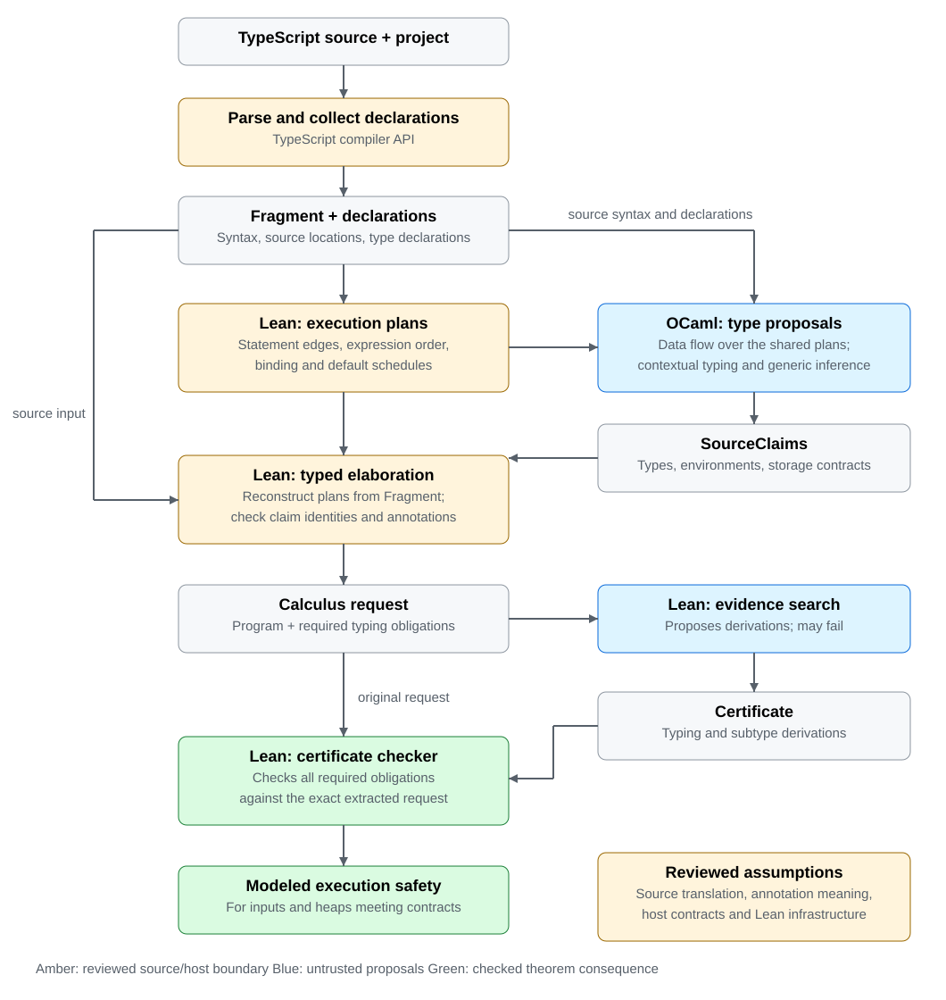

<p align="center"></p>

# TScert

TScert checks that TypeScript functions are type-safe, and accepts a function
only with a proof. A checker whose soundness is proved in Lean validates that
proof. It never trusts the types that TypeScript or the proposing tools infer;
what it does trust is listed under [What acceptance means](#what-acceptance-means).

## Why

TypeScript's type checker is deliberately unsound in places: `any`, type
assertions, unchecked index reads and covariant arrays let programs that pass
`tsc` still read `undefined` where a type says `string`. TScert gives a stronger
answer for the code it accepts: for every input that meets its annotations, the
function's translation into a formal model never applies an operation to a value it does not fit, and never
returns a value outside its result type. A theorem in Lean states that
guarantee, and the checker that decides acceptance is the code the theorem is
about.

## An example

TypeScript accepts this function (under `strict`, which leaves
`noUncheckedIndexedAccess` off). TScert refuses it:

```ts
export function stale(xs: string[]): string {
  const n = xs.length;
  xs.pop();
  return xs[n - 1]; // past the end after the pop: undefined at run time
}
```

Abridged output (offsets refer to the example file):

```text
"status": "unverified"
reject: source expression obligation at [219,228): evidence search failed: no derivation of its return-contract claim
obligation: The available claim for xs[n - 1] is undefined | string. This return requires string.
```

With the result type stated honestly, `string | undefined`, TScert accepts it.
Both versions are pipeline cases:
[`invalid-array-last-after-pop.ts`](pipeline/examples/invalid-array-last-after-pop.ts)
and `afterPop` in [`array-last-element.ts`](pipeline/examples/array-last-element.ts).

## How it works



1. **Parse.** A front end on TypeScript's compiler API reads the source and the
   declarations it uses.
2. **Plan.** Lean turns the source into execution plans: control flow, operand
   order, bindings.
3. **Propose.** An OCaml program, the *producer*, proposes the type of every
   expression and variable over those plans. Its answers are *claims*, and
   nothing it says is trusted.
4. **Elaborate.** Lean translates the function, with the proposed types, into a
   small formal language (the *calculus*) whose execution and safety are
   defined in Lean.
5. **Search, then check.** An untrusted search in Lean looks for a
   *certificate*, a derivation that the program meets its types; the trusted
   checker validates it against the exact translated program.

Colours in the diagram: blue parts propose and may be wrong; green parts check,
with a proved safety consequence; amber parts translate source and are trusted
on review and tests. Grey boxes are the documents passed between stages: the
*Fragment* is the parsed source, *SourceClaims* the producer's claims, and the
*calculus request* the translated program with the obligations it must meet.

## What acceptance means

Acceptance proves, of the function's translation into the calculus, that for
inputs and a heap meeting their declared types it does not get stuck and does
not return a value outside its result type. It may throw or run forever. The
theorem is
[`checkJson_safe`](lean/Verification/Source/Claims/Json.lean). Some things are
trusted rather than proved:

- that the translation from TypeScript to the calculus is faithful (reviewed and
  tested, not proved);
- that library and host functions behave as their reviewed contracts state;
- that callers and imports meet their declared types;
- Lean itself.

The [trust surface](docs/DESIGN.md#trust-surface) lists every assumption, and
[what "verified" means](docs/DESIGN.md#what-verified-means) states the guarantee
exactly.

## Status

TScert is a research project. It handles a substantial subset of TypeScript;
the [status table](WORK.md#status) records what works and what is open,
including how much of TScert's own front end it verifies, the benchmark that
drives its development.

In outline, the supported subset covers:

- `const`/`let`, patterns, `if`, `switch`, loops including `for...of` and
  `for...in`, labeled blocks, `throw` and `try`/`catch`/`finally`;
- primitives with literal types, arithmetic, comparisons, template literals,
  `typeof`, `in`, `instanceof` and strict equality;
- object literals with spreads, records, index signatures, arrays and tuples,
  optional chaining, enums, and classes with fields, methods and a base class;
- functions, closures, optional, default and rest parameters, generic functions
  certified for every admissible type argument, `async` and `await` of promises of
  primitives;
- declared types: aliases, interfaces, unions, intersections and library types
  through reviewed contracts.

`any` is refused, and a type assertion (`e as T`, `e!`) decides nothing. Every
unsupported form is refused with a reason and a location. The
[fragment boundary](docs/SOURCE-FRAGMENT.md#fragment-boundary) lists what is
refused and why.

## Try it

Prerequisites: Node, the pinned [Lean toolchain](lean/lean-toolchain), OCaml
and Dune ([the producer guide](ocaml-producer/README.md#try-it)). Then:

```sh
make setup                                   # node dependencies
make build                                   # the Lean verifier and the OCaml producer
make check FILE=pipeline/examples/array-last-element.ts
```

`make check` prints the outcome and the directory holding the run's documents:
the source, the parser's output, the producer's claims and the certificate.

## Develop

```sh
make test     # fast checks and the controls (forged documents and claims)
make suite    # every pipeline case: source files with their expected outcome
make help     # every target
```

## Read next

- [DESIGN](docs/DESIGN.md): principles, architecture, the trust surface, and the
  [documentation map](docs/DESIGN.md#documentation-map) of every document.
- [SEMANTICS](docs/SEMANTICS.md), [POSITIVE-TYPES](docs/POSITIVE-TYPES.md),
  [PROGRAM-TYPING](docs/PROGRAM-TYPING.md): the calculus, its types and its
  typing rules.
- [SOURCE-MODEL](docs/SOURCE-MODEL.md),
  [SOURCE-ELABORATION](docs/SOURCE-ELABORATION.md),
  [SOURCE-CONTRACTS](docs/SOURCE-CONTRACTS.md),
  [SOURCE-FRAGMENT](docs/SOURCE-FRAGMENT.md): how TypeScript values and
  operations map to the calculus, how each source form lowers, how types and
  library contracts are read, and what the fragment refuses.
- [AGENTS](AGENTS.md): the rules for changing the project: what a change
  must carry, which tests to keep, and how commits are recorded.
- [WORK](WORK.md): open work and its status.
- [Pipeline cases](tests/README.md): worked examples of every supported
  construct, positive and negative.
- [REFERENCES](docs/REFERENCES.md): the work TScert draws on.

## License

Licensed under the [MIT License](LICENSE).
