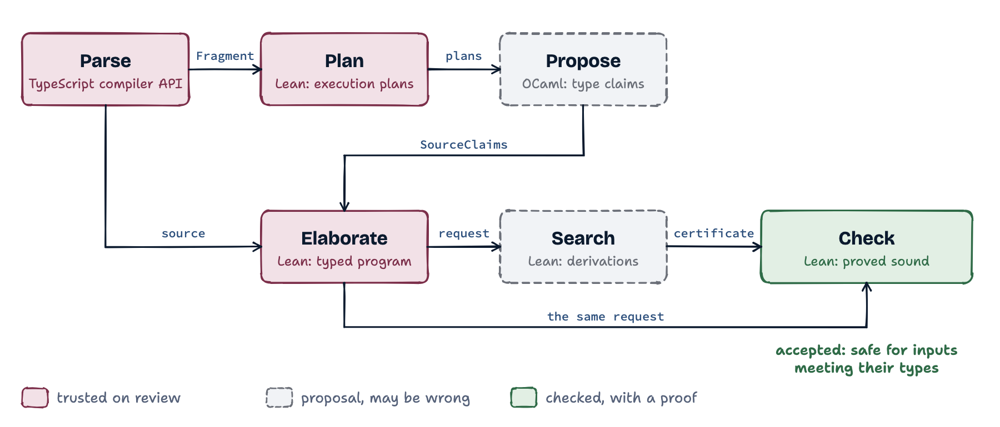

# Independent verification of type claims

The pipeline checks type claims about TypeScript programs with a small,
independently justified consumer. A producer proposes the types of a
module's expressions and the environments at its program points; Lean checks
that those claims are derivable in a calculus whose rules are proved sound
against an execution model. The OCaml producer, which reads TypeScript's own
declarations, supplies the claims. No producer is trusted.

This document owns the principles, architecture, trust surface and lasting
decisions. [The source model](SOURCE-MODEL.md) connects source constructs to
the calculus. [The fragment boundary](SOURCE-FRAGMENT.md) states the restrictions
the source pipeline enforces. [The work ledger](../WORK.md) records open work and
its completion conditions. The [documentation map](#documentation-map) assigns
them: terms, values and execution to [SEMANTICS](SEMANTICS.md), types and
subtyping to [POSITIVE-TYPES](POSITIVE-TYPES.md), program and source rules to
[PROGRAM-TYPING](PROGRAM-TYPING.md), wire formats to
[REQUEST-PROTOCOL](REQUEST-PROTOCOL.md) and [SOURCE-CLAIMS](SOURCE-CLAIMS.md).
Works the design draws on are cited from [REFERENCES](REFERENCES.md).

## Principles

**Utility justifies complexity.** Support ordinary, useful programs well;
support for every JavaScript corner case is not an objective. When a rarely
useful behavior would require disproportionate machinery, prefer a simple
semantic restriction with a clear refusal. State the restriction explicitly,
enforce it, and require external code to respect it wherever the result relies
on that assumption. This is a choice of admitted language, not permission to
ignore behavior of an admitted program or erase a difficult contract. The
ordinary-array construction restriction is one such trade-off. A motivating
ordinary program is not a corner case merely because its implementation is hard.

**Library models follow project use.** A complex library is supported through
an explicit contract for useful project operations. Preserve the complete
contracts those operations rely on; use restrictions for excluded behavior
and existing general mechanisms for admitted behavior. Extra library breadth
is justified by useful programs. A simplification is evaluated by the project
suites and census, including lost coverage, rather than by the size of one
example. [Modeling a library](SOURCE-CONTRACTS.md#modeling-a-library) gives the
method.

**Soundness is no wrong values.** An accepted unit, run in any environment
meeting its inputs, evaluates to a value of its declared type, takes a step,
or throws a value: it never gets stuck and never produces a value outside its
type. A throw is an outcome, as in ML-style soundness with exceptions
([Wright and Felleisen 1994](REFERENCES.md#wright-and-felleisen-1994)): a type
says what a value is, never that none is thrown. Termination is not claimed.
What is refused because it could produce a wrong value stays refused; what
would only throw is admitted (`BigInt(1.5)`, a bigint division by zero,
`toString(radix)` out of range).

**Types express what is actually true.** A type states what holds of every
value JavaScript can give it, no more. `s[i]` is `string | undefined`, since
a string's length is not tracked; a number's falsy part is all of `number`,
since no type names `{0, -0, NaN}`; an array may own keys its type does not
name; a fresh literal owns exactly its written keys, and a record type is
open. Where TypeScript states more than is true, the model states less, and
the program must justify the rest.

**Lean is the authority; OCaml proposes.** Claims, contracts, instances,
loop heads and construction hints are proposals. Lean checks every proposal
used to establish an extracted obligation against the source it reads itself. Search strategy, fuel and hints
decide whether evidence is found, never what acceptance requires. A search
that finds nothing leaves a unit *unverified*, never disproved. The consumer
must stay usable with evidence from any producer.

**One mechanism, not two.** A new source form reuses the rules that exist:
every guard is a tag test; every array is one store and one prototype; every
intersection is one meet; every body, function or closure, is graph code;
every library contract is read through one overlay mechanism; one headline
theorem covers every accepted unit. A second typing path for a case the first
covers is not added, and a form that needs one waits until the first is
extended.

**Follow TypeScript where it is sound; refuse, with a reason, where it is
not.** The source is TypeScript and the pipeline reads it as TypeScript's
checker does: names resolve as it resolves them, computed types mean what it
computes, contextual types are its. Where TypeScript's rule is unsound
(method bivariance, covariant mutable arrays, implicit index signatures,
width subtyping into optional fields, narrowing an open record by `in`), the
form is refused with the specific reason, located at the source. Where
TypeScript refuses what would merely throw (arithmetic mixing a number and a
bigint), the pipeline follows it too: its rule is sound and the program is
almost surely a bug.

**Minimal, stated trust.** Every assumption is named and enters the safety
theorem as a premise: an input slot of the unit at a declared type, or a
listed property of the host. The [trust surface](#trust-surface) lists all of
them. Library contracts are TypeScript's declarations filtered by reviewed
overlays that record the text they were reviewed against, so a changed
library is refused rather than trusted silently.

**Evidence is syntax-directed.** Entry claims attach to execution points,
and expression claims to sites within those points; loop heads and joins are supplied, and every incoming edge
must justify them. The checker infers no invariant and computes no join. What
a producer states at a program point is exactly what is checked there, and
source maps, which say how a node reads in the source, never reach evidence.

## Architecture

The pipeline has two distinct jobs: proposing type information and checking
whether that information follows from the program. It also has two stages of
lowering, meaning translation into a simpler program representation. The first
fixes execution order without needing types; the second constructs the typed
calculus program that the verifier checks.

<picture>
  <source media="(prefers-color-scheme: dark)" srcset="../diagrams/architecture-dark.png">
  
</picture>

The diagram uses the [roles](STYLE.md#roles) of the design language. Maroon
marks translation whose correspondence with JavaScript is reviewed and tested.
Grey dashed boxes mark replaceable proposals. Green marks checking with a
proved safety consequence for the extracted calculus program, which the
checker receives from elaboration itself, beside the certificate the search
proposes.

### Stages

1. **Parse source and collect declarations.** The TypeScript front end reads
   source using the project's strict compiler configuration. It emits a
   **Fragment**, a syntax tree for the supported source constructs, and a
   declaration graph describing the types and external values the source uses.
   Parsing includes source rewrites such as representing `switch` with labeled
   blocks. These rewrites must preserve JavaScript behavior.
2. **Build execution plans in Lean.** Lean derives a statement graph and
   schedules for expression evaluation and binding. A graph edge records where
   execution can go, including a transfer through `finally` or an exception
   handler. Expression schedules record operand order and conditional
   evaluation. Binding schedules record parameter defaults and destructuring.
   These plans depend on source syntax, before the producer supplies claims.
3. **Propose types in OCaml.** The producer follows the exported plans and
   computes environments along their edges. An **environment** records the
   proposed types of local bindings and facts about their current contents.
   At a loop head, the producer seeks an invariant that is preserved by the
   loop's back edges. Source syntax supplies contextual types, generic-call
   inference and other type information. The output is a claims document.
4. **Elaborate the typed program in Lean.** Lean reconstructs the execution
   plans from the Fragment. It checks claim identities, interprets annotations
   and proposed types, and elaborates operations into a **calculus graph**:
   the program over which typing and safety are defined. This stage can depend
   on types, for example when choosing how to read an array element or a field.
   It produces a request containing that graph and the obligations it must meet.
5. **Search for evidence.** Lean's search procedure proposes a **certificate**,
   a finite description of typing and subtype derivations for the request.
   Search can fail or exhaust its budget even when the obligations hold.
6. **Check the certificate.** The verifier checks the proposed derivations
   against the exact extracted request. Success establishes safety for that
   calculus program under its stated input and host assumptions.

The OCaml producer analyzes the early execution plans; it does not need a
finished typed calculus graph. This ordering avoids the circularity in which
expression lowering needs types that the producer has yet to infer. The
exported execution-plan document is an input to proposal generation. Acceptance
uses the plans Lean reconstructs from source, rather than trusting that document.

Implementation entry points are [the parser](../tools/fragment-parse.mts),
[the execution-plan writer](../lean/Verification/Source/FlowJson.lean),
[the OCaml producer](../ocaml-producer/README.md),
[typed extraction](../lean/Verification/Source/SourceExtraction.lean) and
[claim checking](../lean/Verification/Source/Claims/Json.lean).
[LANGUAGES](LANGUAGES.md) maps each representation to its definitions.

### Claims and the claim reader

A **claim** is a proposed type or state description. It becomes an obligation
where extraction uses it. A **source span** is a pair of offsets locating
syntax in the source file. An **execution point** identifies a node in a body's
statement graph. One span can occur at several points: a finalizer, for example,
can execute on a return path and on a loop exit.

Entry claims are identified by execution point. Expression claims use both a
point and a span, since one statement can evaluate several expressions.
Mutable declarations have separate **storage contracts**, the types every
value written to their cells must satisfy. A point's current-content claim
may be narrower than that contract; it does not change what later writes allow.
The [claims protocol](SOURCE-CLAIMS.md) defines the identities and encodings.

Lean validates point ownership and source-site membership, rejects duplicate
identities, and requires the claims needed by extraction. It reads source
annotations independently. A function's proposed signature must agree with its
annotation; a closure must justify the signatures claimed for it and meet its
written annotation. An unused display claim is not thereby certified: acceptance
covers the extracted program's required obligations, not every candidate a
producer might include at a valid site.

Types are interpreted through a common graph of recursive type equations.
A **type label** names a type in that graph; the label's number or spelling
has no independent meaning. Comparisons use the types denoted by labels.
[RECURSIVE-EQUATIONS](RECURSIVE-EQUATIONS.md) defines that interpretation.

The extractor also writes a **source map** linking calculus nodes and local
slots to source descriptions. Diagnostics use it to locate failures. It is
diagnostic metadata and supplies no evidence for acceptance.

### Search

Search tries to construct evidence for each required typing or subtype
judgment. Some operations have evidence determined by their elaboration;
others require searching among types and rules relevant to the request.
Recursive subtype comparisons use finite certificates whose dependencies the
checker validates. The details belong to
[recursive subtyping](RECURSIVE-EQUATIONS.md#4-subtyping) and
[evidence construction](SOURCE-ELABORATION.md#producing-evidence-from-supplied-claims).

Search is replaceable. It cannot change the source requirements, and an
unsuccessful search is not evidence that a program is unsafe. The OCaml
producer's `--explain` output and TypeScript diagnostics can help explain a
failure; neither is a premise of certificate checking.
[Failure classification](OBLIGATION-DIAGNOSTICS.md) specifies these distinctions.

### The pipeline entry point

`pipeline/verify-source.mts` runs parsing, execution-plan export, OCaml proposal
generation, Lean evidence search and Lean checking. Each subprocess has a log
and a time limit. `--project` selects the strict TypeScript project configuration.
The pipeline cases use this entry point.

The outcome is one of:

- **verified**: certificate checking accepted the extracted request;
- **unsupported**: source processing or proposal generation refused a construct;
- **unverified**: search or checking did not establish the required derivation;
- **exhausted**: a verification resource budget was reached before the
  obligation could be decided;
- **error**: a `tool failure`, which certifies nothing: a subprocess
  killed by a signal, past its time limit, or exiting without its complete
  refusal record (the verifier's exit status 1, the producer's 2, a first
  line `reject: …` or `unsupported: …` and a last line `end of refusal`;
  each exits 3 with a first line `error: …` on an operational failure, a
  file it cannot read or write among them); the producer's `--explain`
  failing or printing no explanations; any failure of a file-system
  operation of the front end, each made in one module
  (`tools/files.mts`), other than a path naming nothing where that absence
  has a meaning; or a failed request to the compiler's API, which
  names the query, the front end's call site and the compiler's reason. Every request goes through one guard
  (`tools/compiler-channel.mts`), which makes whatever it throws a
  `CompilerFailure`: a reply the compiler sent as an error, a transport or
  native I/O failure, before or after the request was written, or the front
  end exhausting the call stack, which may interrupt a query mid-reply. A
  tool failure is never made a refusal, an absence or an unknown answer:
  every front-end catch passes it on, and one caught within a located read
  keeps that location. After a panic the compiler replied, its channel stays
  readable; after any other tool failure the compiler is abandoned without a
  further request, its process killed, and the next parse opens another. A
  failure closing the compiler is a tool failure that names what was in
  flight. The compiler's API (typescript 7.0.2)
  panics writing the type of an empty array literal TypeScript types as a
  tuple (`[] as const`, or `[]` where a destructuring or a tuple type is its
  context) into a reply, observed of `Checker.getTypeAtLocation` and
  `TypeObject.getTypes`; a query whose reply holds that type is such a tool
  failure, and its report names the cause. A literal whose type no query
  asks is unaffected (`constructor-tuple-spread`, `as-const`): the front end
  reads an iteration's kind from a conditional's arms and from an array
  literal's syntax, so `c ? xs : []` asks no type holding the literal's
  (`conditional-empty-array-pattern`), and TScert's own source forms no
  other ([the empty-tuple panic](SOURCE-REWRITES.md#the-compiler-apis-empty-tuple-panic)).

A whole-file failure can precede claim generation.
Neither an unsupported result nor an infrastructure error is a safety verdict.

### The stage store

Every stage of the entry point and every operation a control runs goes
through one invocation mechanism and replays from one content-addressed
store ([the stage store](STAGE-STORE.md)). A stage's key is the digest of
its implementation (the executable, the keyed node-side code, the runtime)
and its complete input description ([keys](STAGE-STORE.md#keys)); the parse
and TypeScript's diagnostics, whose inputs are known only after they run,
are keyed by the file system's answers to their reads as
[observed stages](STAGE-STORE.md#observed-stages), a worker's declaration
compiler retained between them
([retained declaration sessions](STAGE-STORE.md#retained-declaration-sessions)); timeouts are recorded at
their limit ([entries and timeouts](STAGE-STORE.md#entries-and-timeouts));
every attempt records its timing ([timing](STAGE-STORE.md#timing)); and
the store keeps itself within a size budget by evicting the least recently
used items ([location and size](STAGE-STORE.md#location-and-size)). A
replayed check, parse or control operation is a trusted step: the trust
surface's rows state what each replay assumes.

### What "verified" means

`SourceClaimJson.checkJson_safe` connects successful source-claim checking to
safety of every certified calculus request. Each **code unit** is a function
or module-initialization body. Its inputs include parameters and the module,
imported and host values it uses.

For inputs that satisfy their types and a heap that satisfies its storage
contracts, the extracted program does not get stuck or return a value outside
its result type; a type guard's or an assertion function's returns keep its
promise. It may throw or run forever. Generic units have this guarantee
at every admissible assignment of their type parameters. All extracted plans
pass through the checked conversion to `CertifiedPlan`; acceptance cannot
silently omit an unhandled kind of plan.

This is a theorem about the extracted calculus program. Correspondence between
source JavaScript and that program, the interpretation of annotations, and the
host's compliance with assumed contracts remain review obligations. The
[trust surface](#trust-surface) lists them. The proofs, checked by
[Lean 4](REFERENCES.md#lean-4), use no `sorry` and no
project axioms; that fact does not itself establish source correspondence.
See [the semantic guarantee](SEMANTICS.md#lean-files)
and [trust-reduction options](TRUST-REDUCTION.md).

### Function coverage and release thresholds

The headline benchmark and release metric is function coverage of `tools/`,
the front end. Its denominator is every named top-level function declaration
with a body in that directory; its numerator is those whose complete census
slice verifies. Unsupported, unverified, timed-out and failed functions
remain in the denominator. Each function counts once, including functions
sharing a mutually recursive slice. Function size carries no weight. Module
initialization, class members and functions held by module bindings are
outside this census scope.

A release `v0.N` requires at least `N × 10%` of these functions to verify in
the complete census of `tools/` on main. A selected-file or selected-function
run is a targeted check, not the release benchmark. A report states the
verified count, total count and percentage together. Comparing releases uses this same directory and unit
of counting. This is a census of functions, not a claim that the same
percentage of source statements or all project code is verified.

Censuses of `dev/`, `tests/` and `pipeline/` are reported under their own
directory names; an aggregate of directories is labelled with its scope.
[Statement coverage](#statement-coverage) is a separate measure, weighted
by the statements inside the census functions. Neither replaces the
front-end function percentage in a release or headline comparison.

### Statement coverage

Statement coverage states how much of a directory's source a census verifies,
as a percentage that sums over files and functions. Its unit is an
executable source statement of the original source, before lowering, each of
weight 1.

**Inventory.** The units of a module are its statements that execute:
variable statements, expression statements, `if`, `do`, `while`, `for`,
`for...in`, `for...of`, `continue`, `break`, `return`, `with`, `switch`,
`throw`, `try`, `debugger`, `export default` of an expression, class
declarations and enum declarations other than `const enum`. Blocks, empty
statements, labels, imports, exports of bindings, function declarations,
type-only and ambient declarations are none. A compound statement owns its
header (a condition, a `for` head, a `switch` discriminant and its cases);
each statement of its branches or body is a unit of its own. A statement
owns its expressions, except the bodies of the functions they hold. A class
field's initializer is a unit, and an arrow whose body is an expression has
one unit for that expression, its implicit `return`. A parameter's default
belongs to no unit.

**Ownership.** Each unit belongs to the function whose body holds it, and a
nested function's units belong also to the top-level function enclosing it.
A top-level function declaration with a name and a body is a census
function: the census slices exactly these. A unit outside every function
belongs to `<module>`; a unit of any other function directly at module level
(a class member, a function a module binding holds) belongs to that
function, outside the census's scope.

**Classes.** A unit of a census function is *verified* when the census
slice of its top-level function verified: the slice's source acceptance,
imports included, covers that function, and so every function nested in it.
Every other unit of a census function is *not verified*, classified by its
slice's outcome (`unsupported/source`, `unsupported/proposal`,
`unverified/search`, `timeout`, `error/…` for a tool failure, and the other
outcomes a slice can have). Units of `<module>` and of functions outside the
census's scope are *out of scope*, and units of a census function no slice
of the record covers are *not run*; both are reported and not counted.

**The measure.** With $`V`$ the verified units and $`N`$ the counted ones
(verified and not verified), verified coverage is $`100\,V/N`$, `n/a` for
$`N = 0`$, reported with verified functions over census functions. File and
directory figures sum $`V`$ and $`N`$ first; percentages are never averaged.
While `<module>` and functions outside the census's scope are not counted,
the measure is *top-level-function-body coverage*. Equal weights measure
statement sites, not code size or difficulty, and no syntactic unit is
invariant under every refactoring: splitting a function, adding trivial
statements or dead code moves the denominator, which comparisons report
separately.

**Comparison.** Two censuses compare on matched units: a unit's identity is
its file, its top-level function, its kind and its ordinal among that
function's units of that kind. A unit matched on both sides counts in the
transition between verified, not verified and not counted; a unit on one
side only counts as deleted or added. The comparison reports additions
and deletions separately for counted statements and for the complete
inventory, which also contains out-of-scope and not-run units. Only
counted statements contribute to the coverage denominator; matched units
that enter or leave the counted set also move that denominator.

**Records.** A census record holds each file's source hash and its
inventory, every unit with its file, span, position, kind, owner and class
([`dev/statement-coverage.mts`](../dev/statement-coverage.mts)). The measure
of an existing record is computed from the sources of the record's commit,
or of the checkout for a census of a dirty tree, compared with the record's
hashes per file, or per slice for a record without an inventory.

### Modules and code units

The module is the unit of source verification. Its top-level functions and
initialization body have separate obligations, so a failure can name the
responsible code unit. Initialization evaluates constants, classes, enums and
top-level statements in source order; class constructors and methods receive
their own code checks.

A module function is available at its source signature and, without a rest
parameter and without type parameters, also at that signature extended by a
rest of `unknown`: its code discards further actuals. A module constant is
available at its annotation or its checked initializer claim, and an
unannotated one holding a closure without a rest, binders, defaults or a
guard also at that closure's signature extended so. Initialization
refuses calls that could read a constant before it is initialized. Imports,
ambient declarations and globals enter at assumed declared types.
[Module rules](SOURCE-CONTRACTS.md#modules-and-code-units) specify these interfaces.

Each unit's theorem assumes the signatures of the module values it reads.
A Lean theorem composing these unit guarantees for an entire module execution
is [open work](../WORK.md#module-composition).

### Generic bodies

A generic type parameter denotes an arbitrary type satisfying its bound.
The calculus represents it with a **parameter row**, a type-graph entry whose
interpretation is supplied when the generic is instantiated. Typing rules may
use its declared bounds but cannot inspect that arbitrary interpretation.
`Parametricity.accept_reassign` proves that accepted evidence remains valid
when the interpretation changes.

A bounded parameter such as `T extends A` is interpreted as the intersection
of its arbitrary type with `A`. A bound `U extends T` relates the parameters
by the same intersection construction. A generic call proposes a substitution
for the parameters; Lean checks the instance and its bounds. The producer
proposes it as TypeScript infers it: the binders the receiver and the
expected result fix come first (a receiver that is a union of arrays fixes
the element binder at the union of its arms' elements, as TypeScript reads
a method of `A[] | B[]` at `(A | B)[]`), and a callback actual is typed at
its parameter read at them, so its body's object literal is built at the arm
of the contextual result it fits (`callback-literal-context`,
`blocker-callback-literal-union-receiver`). An argument at a parameter
placing the call's binders that have no bound at tuple positions
(`readonly [K, V]`, a Map's entries) is typed against it with those binders
left open: an array literal, also one a callback returns into such a
position, is a tuple, each position holding an open binder at its element's
widened type, and the binders are inferred from it (`generic-tuple-context`).
Generic classes and closures use this mechanism too.

A **type scheme** is a callable contract with universally quantified type
parameters. A generic closure is checked at its scheme's signatures with
fresh parameter rows, including the types of captured values. It is checked
for all admitted instances, rather than only for calls observed in the source.
See [generic typing](CALLABLES.md#overloads-polymorphism-and-binding) and
[parameterized equations](RECURSIVE-EQUATIONS.md).

### Closures are graph code

A closure's body is a calculus graph with its own certificate. Its entry receives
a receiver, arguments and captured values. A mutable capture is the identity
of its cell; its creation-time contents cannot be assumed when the closure
later runs. Each claimed call signature must be justified by the body.

Parameter defaults execute at entry in source order. A rest parameter collects
surplus arguments into fresh array storage. Constructors have construct
signatures, checked against constructor code; callable objects combine code
with property storage. `.bind` creates a forwarding value with a retained
receiver and arguments. These forms share the model's call and code checking
rather than relying on a special source-level acceptance test.

The creating body's certificate identifies the checked closure code and its
captures. [Graph code](SEMANTICS.md#graph-code) and
[call rules](SOURCE-ELABORATION.md#source-closures-and-their-annotations) define the entry frames and obligations.

## Trust surface

Everything the safety theorem does not establish. Each assumption enters as
a premise: an input slot of the unit at a declared type (`EnvOk` over the
unit's inputs, in the premise of `checkJson_safe`), a property of the host
the model's reading of an operation relies on, or the correctness of a
trusted tool. Where an item is stated in code, that code is the reviewed
text.

Equation well-formedness and inclusion are proved over the lowered equations
([validation and soundness](RECURSIVE-EQUATIONS.md#6-trust-and-acceptance)).
Interpreting source annotations as those equations is part of source extraction's
trusted obligation below.

**Trusted tools.**

| Assumption | Where it is stated |
| --- | --- |
| The parser represents the source faithfully: it admits only the fragment, and its lowerings (unbraced arms, `switch`, `for`, templates, enums, optional chains, async forms (each callable definition's completion kind, `sync` or `async`, from its own modifier), a written signature's statement of its effect (`Within<F, T>`, by the declaration TypeScript binds `Within` to, where it is the result annotation, and refused elsewhere; [stated effects](SOURCE-ELABORATION.md#stated-effects)), patterns, dead code, a shadowing local's renaming by the declaration TypeScript binds each reference to, a namespace member read as the binding of the export TypeScript binds it to, a `let` nothing writes as a `const` (a `for...of` or `for...in` head's too), a `for...in` whose body reads the entry at its key before anything that could change it runs as the steps of `%Iterate:ForIn%` with that read the step's value (`forInEntryReads`: the object's name written nowhere in the outermost function holding the loop, and a chain of reads from it unchanged by a body that runs no code and writes no property), a written `let` pattern as a `const` pattern and `let`s, a `for...of` pattern binding as a `const` pattern over the element at the body's start, a static block as a closure called at once, a class's static field initializers as bindings before the class value, which holds them as its fields, `instanceof` of a class with a static `[Symbol.hasInstance]` as its call, `k in o` with a key TypeScript types as other than string literals as `%HasProperty%(k, o)`, `xs[k]` of an array, a tuple or a node list at a `number` key as `%ElementAt%(xs, k)`, `b[k]` at a number and `b.length` of a view of bytes as `%ByteAt%(b, k)` and `%ByteLength%(b)`, an element read in an optional chain as either on the chain's present value, an element read a call takes as its callee as a member read, a call of a member read through `!`, `as`, `<T>` or `satisfies` as the call of the member's value with its object, saved, as the receiver, a private name as its member's symbol, a regex literal as a call of `%RegExp:Σ%` for its shape, an array literal's spread of a host iterable as a spread of `%Spread:K%`'s array, `s.m(o, …)` of a string method dispatching to an object `o` as `%Dispatch:m%(s, o, …)`, a type guard's or an assertion function's `return e` of a Boolean by its form as `if (e) return true; else return false` ([derived source forms](SOURCE-ELABORATION.md#derived-source-forms)), a rest parameter's alias equation, the iterator protocol of a program's iterable in a `for...of`, a spread and an array pattern, with its closing region) preserve JavaScript's execution. | `tools/fragment-parse.mts` and its parts (`fragment-classes`, `fragment-expressions`, `fragment-guards`, `fragment-statements`, `fragment-support`), `fragment.mts` |
| Source extraction preserves control flow, lexical binding, evaluation order and annotations: which program point a claim is attached to is unproved. No source-to-graph preservation theorem exists. A key-adding write is lowered as a copy only where every reference to the object is a local holding it, the one that allocated it or a constant bound to it since, and the copy is rebound to each (`growSites`, a syntactic analysis; a holder is found in scope by its name and declaring statement): that JavaScript's write in place and the copy agree rests on it, and, at a string key known only at run time, on the dispatch that leaves the object as it is where the key is `__proto__` and the object does not own it. That a `new` of a class the file declares returns an object nothing else holds rests on the parser's class lowering (the constructor reads no `this` and ends in the allocation). A mutable binding is held in a slot of its activation where `cellLocals`, a syntactic analysis, finds no closure that writes it and no write after the creation of a closure that mentions it: that the binding is then its activation's alone rests on it. A condition in a test position is lowered by the short-circuit translation, each operand dispatched on its truth and `!` exchanging the outcomes, and a leaf reading an immutable binding whose context type answers the test takes that arm alone: that these evaluate the operands as the operators do and take the edges a run takes rests on the equations of [conditions](SOURCE-ELABORATION.md#conditions). | `Source/Fragment.lean`, `Source/SourceFacts.lean`, `Source/SourceExtraction.lean` |
| Decoding represents the submitted AST, declarations, claims and evidence faithfully. The evidence document's references resolve to the values they unfold to ([evidence document](REQUEST-PROTOCOL.md#evidence-document); proved for the derivations, `EvidenceWire.proofs_unfold` and `EvidenceWire.unfold_unique`; the types, contexts, links, separation facts and knowledge by direct lookups, audited); the strict decoder reads its tables' shapes. | `RequestJson.lean`, `Claims/Json.lean`, `EvidenceWire.lean` |
| TypeScript's checker resolves each name to its declaration in the file's project, whose strict `tsconfig.json` (paths, links, library set, type packages) reflects the real build; a TypeScript error in a collected declaration or on an import it passes through refuses the graph. The parser checks TypeScript read the bytes it parsed. | `tools/declaration-graph.mts` |
| TypeScript's evaluation is trusted as its resolution is: a computed type (`typeof`, `keyof`, `T[K]`, template literal types, conditional types, primitive intersections, mapped keys) means what its checker computes; a computed form naming a declaration's parameters, at an application, means what the checker computes for a probe declaration with that declaration's parameters (merged across its declarations) and the application's arguments copied verbatim, every copied name checked to resolve to what it resolves to where it is written (a parameter of the declaration, merged parts included, to the probe's parameter at its position), the generated reference checked to bind to the inserted probe declaration, and the answer read from the inserted declaration found where it was placed ([written applications](SOURCE-CONTRACTS.md#written-applications)); an enum member's value is `getConstantValue`'s, which its emit writes; a `const enum` read is the member TypeScript binds it to; global member and overload resolution selects which declared signatures are assumed. | [`tools/computed-types.mts`](../tools/computed-types.mts), [`tools/type-probe.mts`](../tools/type-probe.mts), `declaration-graph.mts` |
| The capture-shape reading of a regex literal is correct: for every literal it reads, the number of capture groups and whether a group is named are the pattern's, and a group it reports as taking part in every match holds a string in every successful match under ECMA-262's semantics. The count and the names are also checked against the host's compilation of each literal; which groups take part is the reading's alone. | [`tools/regexp-shape.mts`](../tools/regexp-shape.mts); `tests/regexp-shapes.mts` runs it against the host on known shapes, its counterexamples and a seeded fuzz |
| The execution model agrees with JavaScript on the supported operations, including that Lean's compiled `Float` operations are IEEE-754's and `Float.pow` is C's `pow`, which `binop` corrects where `**` differs. | `Semantics/Calculus.lean`; [ExecutionModelTests.lean](../lean/Verification/Tests/ExecutionModelTests.lean) runs the model where no proof and no pipeline case compares it with JavaScript (NaN, the prototype chain, evaluation order, stuck subterms, reentry), and `tests/node-runs.mts` runs the examples under Node beside their outcomes |
| Lean's kernel, its compiler (including the `@[csimp]` replacements, each proved equal to its definition) and the executed verifier binary are correct. The binary initializes the Lean runtime and the modules it imports, not the rest of the Lean library (`lean_initialize` is replaced, [runtime_init.c](../lean/c/runtime_init.c)). | `lean/lakefile.toml` |
| A replayed check is the verifier's own judgment of exactly the inputs its key binds, so the premise of `checkJson_safe` holds of them: the stage store binds each stored check to the digests of its Fragment, claims and evidence documents, its argument vector (file key, subtype rounds), the verifier executable and its libraries, the keyed direct-child `pipeline/*.mts` code captured at module load and the Node runtime ([keys](STAGE-STORE.md#keys): result-path completeness rests on the stated audits; the replay policy, the store and presentation decide no result and are outside the key, which assumes every version of them that published or reads an entry binds it to its exact manifest), and validates them and every stored file before replay; replay requires both the running Node process and the explicit stage-child environment to contain no `DYLD_` variable; its entries are written only by the user's own pipeline processes. The verifier's check mode reads the three files its arguments name and prints its judgment; the verifier reads no clock, randomness, environment variable or working directory, and runs no task or foreign code beyond Lean's runtime. Cold and replayed runs agree (the replay control of `pipeline/test.mts`). | [The stage store](STAGE-STORE.md), [`pipeline/stage-execution.mts`](../pipeline/stage-execution.mts), [`pipeline/stages.mts`](../pipeline/stages.mts), [`pipeline/stage-store.mts`](../pipeline/stage-store.mts), [`RequestCli.lean`](../lean/Verification/Source/RequestCli.lean) |
| A control passing over replayed operations shows what it showed when they executed: each replayed operation is its executable's own result for exactly the inputs its key binds, under the same binding, validation and audit as a replayed check (the executable by content, its argument vector, its environment, its exit protocol and every input file's bytes). The mutation verifier's audit is the verifier's, beside the one variable `TSCERT_TEST_MUTATIONS` its invocation fixes. A control's own forgery and assertions run at every run. | [Controls](STAGE-STORE.md#controls), [`pipeline/stages.mts`](../pipeline/stages.mts) (`tested`), [`pipeline/evidence-mutations.mts`](../pipeline/evidence-mutations.mts) |
| A replayed parse is the parser's own result for exactly the inputs its key binds: the stage store binds each stored parse (and each stored TypeScript diagnostics list) to its pre-key (the source's bytes, its snapshot path, resolution file and project, the active family descriptions, the keyed direct-child `.mts` files of `pipeline/` and `tools/` captured at module load, and the compiler package's and its executable package's files, the profile, the case sensitivity of the executable's file system, the system's build, the Node runtime) and to its observations, every answer the file system gave the stage, each made again and compared before replay. The observations are complete: the front end reads only through `tools/files.mts` (the parser-based import guard over the keyed in-process universe and the result-path audits under [keys](STAGE-STORE.md#keys)); the compiler, confined by its sandbox profile on macOS, reaches the user's files only through the API's five queries, every one answered by an observation; compiler and loaded-code identities are compared with disk before the stage runs and again before it is published; Node's resolver and loader read what [Node's resolution algorithm](REFERENCES.md#nodejs-modules) and the load hook state, observed before and after, a package resolving through `exports` or `imports` holding no symbolic link in its own tree, and every string target in a package import's scope `imports` map starting with `./` (including targets within condition objects and arrays); each parse opens a fresh parser, a declaration compiler is fresh or a retained session, every compiler's ledger is noted in the records of every stage using it before each of its requests, and the process's caches record their observations, Node's checked for first-answer consistency; within an attempt the front end's own reads of a path answer their first answer ([shared work](STAGE-STORE.md#shared-work)), so a change of the file system during one attempt is seen only by the end-of-stage and replay validations. A stored module entry is the parser's own lowering of exactly the inputs its key binds, under the same binding: an imported module lowered in a parser compiler of its own is the module lowered in the importer's, byte for byte (module isolation, conjectured; every pipeline case's Fragment equal both ways), and its reads of the run's tag selection are complete, the selection being read by family at one site (`familySelection`) and each read an observation the replay evaluates against the invocation's own selection. An incomplete Node resolver or loader observation makes the current execution unpublishable and retires the worker; later observed executions require a fresh process, while validated replays remain available. Elsewhere, or where other observations are not accounted for, the stage executes without publication. | [Observed stages](STAGE-STORE.md#observed-stages), [`tools/files.mts`](../tools/files.mts), [`tools/compiler-channel.mts`](../tools/compiler-channel.mts), [`pipeline/in-process-execution.mts`](../pipeline/in-process-execution.mts), [`pipeline/stages.mts`](../pipeline/stages.mts), `tests/observed-stages.mts` |
| A parse or TypeScript diagnostics list executed in a retained declaration session, its work shared, is the one fresh compilers give for the same inputs and file-system answers with no work shared (conjectured, not proved): the compiler's caches are correct across snapshots whose answers hold; a query of the channel's audited list asked again of an unreleased snapshot answers the text it first answered, and omitting the repeated request changes no later answer of the compiler (query omission, [shared work](STAGE-STORE.md#shared-work)); each collection reacquires its named project from the base state (exactly that project open, no open document, an empty overlay), which the end of every collection, a refusal's included, restores and checks, a failed or uncertain restoration releasing the session and publishing nothing; the session's ledger holds every answer its compiler was given over its lifetime, with its Node-origin bit and incompleteness, is made again before each use and, for every session a stage used, before the stage's publication, and is noted in every record a use makes or begins, so a stored entry's observations include it; compatibility binds the named project, the resolution directory, the compiler's installation and the active families, and the process bounds the session's code and runtime. The controls compare reused parses, their work shared, with fresh ones with no work shared byte for byte in forward, reverse and A–B–A orders, refusals included, and show the invalidations, replacements and failed restorations [retained declaration sessions](STAGE-STORE.md#retained-declaration-sessions) lists. | [Retained declaration sessions](STAGE-STORE.md#retained-declaration-sessions), [Shared work](STAGE-STORE.md#shared-work), [`tools/declaration-session.mts`](../tools/declaration-session.mts), [`tools/files.mts`](../tools/files.mts), [`tools/compiler-channel.mts`](../tools/compiler-channel.mts), `tests/session-reuse.mts`, `tests/shared-work.mts` |

**Assumed values.** Each is an input slot of the units that use it, at its
declared or stated type; nothing checks the code behind it, and each may
throw, which safety admits, but never return a wrong value.

| Assumption | Where it is stated |
| --- | --- |
| An imported value meets its declaration, a guard's declared promise and a [stated effect](SOURCE-ELABORATION.md#stated-effects) (`Within`) included, and a program module's enum the object its emit builds, the reverse mapping included ([enums](SOURCE-CONTRACTS.md#enums)); a function declared with overloads meets every overload; an imported class declaration's binding holds the class its statement creates, and throughout execution the lookup of `Symbol.hasInstance` along the class value's prototype chain finds only data properties (no getter, no proxy trap) and yields the standard method of `Function.prototype` ([imported classes](SOURCE-CONTRACTS.md#imported-classes-and-instanceof)); an imported `unique symbol` constant holds the symbol its declaration names, the one its key names; distinct canonical symbol identities denote distinct run-time symbols, and an alias or a re-export shares its original's identity, as do constants made by `Symbol.for` of the same string literal. | `IMPORT`, `OVERLOADS` in [SOURCE-CONTRACTS](SOURCE-CONTRACTS.md#imported-ambient-and-global-values) |
| An ambient declaration of the checked file (`declare function`, `declare const`, `declare class`, `declare enum`) holds of the value the environment supplies under that name; a global function declared anywhere else is read only through a reviewed overlay entry of its exact text, never at its declaration; an ambient enum's object at its members' object type ([enums](SOURCE-CONTRACTS.md#enums)); the declaration document lists it with the specifier `ambient`. | `AMBIENT`; `collectDeclarations` |
| A host family's stable members, its tag and every property member of its shapes, required or optional, but those its description omits or excludes, read one value for the object's life, an optional one present with one value or absent, and nothing the package or its clients do after creation changes them (F2); the model's host values realize them as locations with stable contracts or absent keys of objects without a prototype (F1′). For the compiler API this rests on an audit of the package's implementation, and C4's corpus reads are regression evidence. | [trust rows](HOST-FAMILIES.md#trust-rows); [stable members as readonly views](COMPILER-API.md#stable-members-as-readonly-views); `tests/compiler-api-shapes.mts` |
| A JavaScript file's JSDoc `@typedef` or `@callback` node, kind `JSTypeAliasDeclaration` (345), which no declaration of the compiler API states, has the compiler-API description's audited shape: `TypeAliasDeclaration`'s `name: Identifier`, `typeParameters?: NodeArray<TypeParameterDeclaration>` (absent, or a dense readonly node list of `TypeParameter` nodes) and `type: TypeNode`, with the members of `DeclarationBase`, `StatementBase` and `ModifiersBase`, at kind 345, so it is a member of `Node`, `Statement` and `Declaration`; these members are stable and their reads transparent as every shape's (F2, F4, T4). It rests on an audit of the package's getters (one child list for 345 and `TypeAliasDeclaration`); C3's corpus walk is regression evidence. | `audited` in [`tools/compiler-api.mts`](../tools/compiler-api.mts); [audited shapes](COMPILER-API.md#audited-shapes); `tests/compiler-api-shapes.mts` |
| A JavaScript file's JSDoc `@import` node, kind `JSImportDeclaration` (346), which no declaration of the compiler API states, has the compiler-API description's audited shape: `ImportDeclaration`'s `importClause?: ImportClause`, `moduleSpecifier: Expression` and `attributes?: ImportAttributes`, with the members of `DeclarationBase`, `StatementBase` and `ModifiersBase`, at kind 346, so it is a member of `Node`, `Statement` and `Declaration`; these members are stable and their reads transparent as every shape's (F2, F4, T4). It rests on an audit of the package's getters (one child list for 346 and `ImportDeclaration`) and of the server at the package's revision of typescript-go: the source files it encodes for the client are fresh parses, a program update reparsing a changed file; in a parse one site builds the kind, from the tag's clause, specifier and attributes parsed by the functions kind 273's are, the specifier never absent, a malformed tag giving a missing identifier; one encoder case sets both kinds' child bits; the client builds no node of the kind but a clone with its children; C3's corpus walk is regression evidence. | `audited` in [`tools/compiler-api.mts`](../tools/compiler-api.mts); [audited shapes](COMPILER-API.md#audited-shapes); `tests/compiler-api-shapes.mts` |
| The compiler API's callback-free node methods its description states at the empty footprint (`getSourceFile`, `getStart`, `getFullStart`, `getEnd`, `getWidth`, `getFullWidth`, `getLeadingTriviaWidth`, `getFullText`, `getText`, `SourceFile.getLineAndCharacterOfPosition`) change no location of the model, on normal return or throw, and `forEachChild` changes none but through its visitors, so a call is within each closed footprint its visitors are within: they make no server request, run no client code but `forEachChild`'s visitors and change no stable member (T3), and their hidden effects are observed by no transparent operation (T4). | `footprints` in [`tools/compiler-api.mts`](../tools/compiler-api.mts); [node methods and callbacks](COMPILER-API.md#node-methods-and-callbacks) |
| The sync API's requests, the methods its views list whose arguments are primitives and host objects, are within `{value: any, store: grow}` on normal return: the client sends primitives and the host objects' ids, so serializing the payload runs no code of the program (audited), and they change no location of the model but through their instance's retained `fs` callbacks and the client's serialization of what those return (T6, T4); the front end's instances are opened by `openCompiler` with callbacks within that footprint returning JSON values the callbacks built (audited), and an external instance's callbacks are within it, their results' serialization included, by T8. | `isRequest`, `requestReading` in [`tools/compiler-api.mts`](../tools/compiler-api.mts); [the sync API](COMPILER-API.md#the-sync-api) |
| The compiler API's host enums the contract lists hold exactly the member values their declarations state ([trust](COMPILER-API.md#trust)); `tests/compiler-api.mts` compares each with the object Node loads. | `hostEnums` in [`tools/compiler-api.mts`](../tools/compiler-api.mts); [trust](COMPILER-API.md#trust); `tests/compiler-api.mts` |
| A compiler-API node list behaves as the dense readonly array of its elements that also owns the members the contract states (T4): `pos` and `end`, prototype getters without setters reading the list's buffer, each giving one number for the list's life; `transformFlags` and `hasTrailingComma`, own data properties the constructor sets to 0 and leaves at `undefined`, which nothing writes, read as readonly at `number` and at `boolean \| undefined`. This rests on an audit of `RemoteNodeList`; C4 runs the members on lists of several lengths and checks that no other code of the package names the two fields. | `hostNodeListMembers` in [`tools/compiler-api.mts`](../tools/compiler-api.mts); [node lists](COMPILER-API.md#node-lists); `tests/compiler-api.mts` |
| A function admitted as a module-function slot keeps its binding's value; the fragment refuses reassignment of that binding. For a script, code reaching a top-level function through the global object preserves that binding and the function's ordinary `call`, `apply` and `bind` properties (`script-global-assumption` runs the excluded global access under Node). A function explicitly passed to other code, returned or exported is subject to the caller contract and the [confinement requirement](SOURCE-ELABORATION.md#calls-through-functionprototypecall); an immutable binding does not freeze the function object's properties (`invalid-call-provenance-module-argument`). | `moduleFunction` and `confined` in `tools/fragment-expressions.mts`; [module functions](SOURCE-ELABORATION.md#module-functions) |
| Each Node module function the overlay of library modules lists meets its entry at the stated arguments: `execFileSync`, `writeFileSync`, `readFileSync`, `existsSync`, `mkdtempSync`, `rmSync`, `realpathSync`, `spawnSync` with both outputs piped and decoded, `readdirSync` with `withFileTypes` at options stating each property Node reads, its entries owning `name` and `parentPath`, `Dirent` and `DirentFromStats` instances keep their audited prototype chains, `DirentFromStats.prototype` → `Dirent.prototype` → `Object.prototype`, whose two Node prototypes hold data properties only, the seven `is…` tests among them callable throughout execution, also in external code, `statSync` at a string path, `mkdirSync` with `recursive: true`, `chmodSync`, `writeFileSync` with a mode, a `Stats` keeping its audited prototype chain, `Stats.prototype` → `StatsBase.prototype` → `Object.prototype`, whose two Node prototypes hold no property its own numbers are named by, the seven `is…` tests data properties holding callable values throughout execution, also in external code, `statSync` with `bigint: true`, a `BigIntStats` keeping its audited prototype chain, `BigIntStats.prototype` → `StatsBase.prototype` → `Object.prototype`, as a `Stats` keeps its own, `readFileSync` without an encoding, `readdirSync` without options, `createHash` at `"sha256"`, every `Hash`, the program's or external code's, keeping `Hash.prototype` as its prototype and owning no `update` or `digest`, `Hash.prototype` holding `update` (at a string or a view of bytes) and `digest` (at `"hex"`) as own data properties, Node's own functions, throughout execution, as its native handle holds Node's own methods, `node:url`'s `fileURLToPath` of one string argument, and `pathToFileURL` of a string, and `node:path`'s `join`, `resolve`, `dirname`, `basename` and `relative`, and its constant `sep`, `"/"` or `"\\"`, which no code writes; `node:os`'s `tmpdir`, a string; a member of a listed module's object read through its default import is the named export it holds, no code replacing a member of that object ([the default import of a Node module](SOURCE-CONTRACTS.md#the-default-import-of-a-node-module)); `node:assert/strict`'s call and its members `ok`, `equal`, `notEqual`, `deepEqual`, `notDeepEqual`, `match`, `doesNotMatch`, `throws`, `doesNotThrow`, `ifError` and `fail`, the module's object unmodified, `ifError` returning only where its value is `null` or `undefined`, and each footprint holding on normal return only. | `modulesOverlay` in [`tools/library-modules.mts`](../tools/library-modules.mts); [rules](SOURCE-CONTRACTS.md#library-modules) |
| The host's values of each type the overlay of library types states meet its statement ([stated library types](SOURCE-CONTRACTS.md#stated-library-types)): every `Uint8Array` and `Buffer`, the program's or external code's, is a host object the host created, which keeps its standard prototype chain (`Buffer.prototype` → `Uint8Array.prototype` → `%TypedArray%.prototype` → `Object.prototype` for a `Buffer`) and owns its elements alone, a lookup along it of `length`, `buffer` and `byteOffset` finding `%TypedArray%.prototype`'s getters and, for a `Buffer`, one of `toString`, `subarray`, `slice` and `utf8Slice` finding `Buffer.prototype`'s data properties, the host's own, no object before them on the chain holding the key, and `Buffer`'s `allocUnsafe`, `allocUnsafeSlow` and `concat` being the host's own, throughout execution, also in external code; every `TextDecoder` keeps `TextDecoder.prototype` as its prototype and owns no `decode`, and `TextDecoder.prototype` holds `decode` as an own data property, Node's own function, throughout execution; `Buffer.from` of a string, `Buffer.compare` of two views, and `new TextDecoder` of a label and options and its `decode` of a view meet their [entries](SOURCE-CONTRACTS.md#nodes-buffer-and-textdecoder); `URL` is an opaque host type, and `new URL` of a string and an optional string base meets its [entry](SOURCE-CONTRACTS.md#nodes-url), under the approved policy that standard objects and prototypes are not tampered with; the host boundary `tools/url-strings.mts` reads a URL it makes and passes nowhere at its `href` ([URLs as strings](SOURCE-REWRITES.md#urls-as-strings)). | `typesOverlay` in [`tools/library-types.mts`](../tools/library-types.mts); the `Buffer`, `TextDecoder` and `URL` entries of `globalsOverlay` in [`tools/library-globals.mts`](../tools/library-globals.mts); `%ByteAt%` and `%ByteLength%` in [`tools/intrinsics.mts`](../tools/intrinsics.mts) |
| Node's `process` and `console` meet their reviewed entries at the members read ([Node's process](SOURCE-CONTRACTS.md#nodes-process)): `argv` an array of strings no code replaces or writes a non-string into, `env` an object whose own entries hold strings and whose chain provides only `Object.prototype`'s keys, `execPath`, `pid`, `execArgv` (as `argv`), `platform` and `arch` (strings), `exit`, `kill`, `console.log` and `console.error`; `setTimeout` schedules its callback with no argument; `structuredClone` of any value returns or throws. The audited Node process and EventEmitter methods retain their standard identities. Host delivery invokes registered callbacks with the audited event arguments and receiver. Deferred delivery occurs between synchronous jobs; every synchronous dispatch occurs within an operation whose contract covers the callbacks' effects. External code preserves callback contracts and storage invariants. | `globalsOverlay` in [`tools/library-globals.mts`](../tools/library-globals.mts) |
| A global variable's binding holds the value its reviewed entries describe throughout the run: no code the module does not see reassigns it. No global is read at its declaration: each member, call, construct or value reading the module selects meets its reviewed entry, wherever the global is declared. | `GLOBAL`; `selectGlobal` |
| For a standard-library global name whose read hoisted spread collection passes, TypeScript resolves its value declarations solely to standard-library `var` or function declarations. Its runtime binding is an ordinary data property: reading the name neither throws nor runs code, and the binding retains the same value throughout collection, including calls into external code. A getter on `globalThis.Set` returning the genuine `Set` violates this, undetectably by the parser: the source reads `Set` before the iterator, the hoisted collection after it (`tests/node-runs.mts`). | [hoisted spreads](SOURCE-ELABORATION.md#the-iterator-protocol) |
| Each standard library global meets its reviewed overlay entry: `console.log`; `BigInt`; `Symbol`, `Symbol.for` and `Symbol.keyFor` (through `%SymbolFor%` and `%SymbolKeyFor%`, which read no receiver) and five well-known symbols; `String` and `Number` of a primitive; `Boolean` of any arguments, called or read as a value, writing nothing; `Math.max`, `Math.min`, `String.fromCodePoint` and `String.fromCharCode` of primitives; `Object.getOwnPropertyDescriptor` of any value at a string, number or symbol key, a fresh descriptor or `undefined`; `Object.getOwnPropertyDescriptors` of any value, a fresh dictionary of fresh descriptors; `Number.isFinite`, `Number.isInteger`, `Number.isSafeInteger`, `Object.is`, `Object.hasOwn` and `Math.random`, as declared; `String`, `Number` and `BigInt` of a primitive and those four writing nothing; `Object.keys`, `Object.values`, `Object.entries` (and the generic two at a dictionary), `Object.keys` and the generic two writing nothing beyond their fresh arrays; `new Array()`; `Array.isArray` and `Array` as `instanceof`'s operand; `parseInt`, `Math.abs` and `Math.ceil` of primitives, writing nothing; `Object.freeze` of an object literal written as its argument, of named fields, returning it, read through `%Freeze:K%` at its fields as readonly views; `Object.fromEntries` and `Array.from` of an array, writing nothing beyond their fresh results; `Array.from` of a length record and a callback; `new RegExp` of strings, a structural regex; `Error` as `instanceof`'s operand, through `%InstanceOf:Error%`, owning no `[Symbol.hasInstance]`; `Map` and `Set` as `instanceof`'s operand, through `%InstanceOf:Map%` and `%InstanceOf:Set%`, owning none either; Node's `clearTimeout` of any value; `new Error(m)`, and `Error(m)` read as it; `new TypeError(m)`, as `new Error(m)` with `TypeError.prototype`, whose `name` is `"TypeError"`, on its prototype chain; `new Set` of an array, a string or a host `Set`, `new Map` of an array or a host `Map`, `new Date` of nothing, a primitive or components, `Date.now`; the `Promise` statics and constructor, through the intrinsics below; `JSON.parse` of a string and `JSON.stringify` of a `JsonValue`. | `globalsOverlay` in [`tools/library-globals.mts`](../tools/library-globals.mts); [rules](SOURCE-CONTRACTS.md#library-globals) |
| A value passing the realm's `instanceof Map` (`instanceof Set`) is a host collection: it has the internal slots `Map.prototype`'s (`Set.prototype`'s) methods read, and its `[Symbol.iterator]`, `keys`, `values`, `entries`, `size` and `[Symbol.toStringTag]` are the standard, unshadowed ones of that prototype, the iterators the native collection iterator; external code keeps this so, by making no object with that prototype on its chain otherwise (`Object.create`, `Object.setPrototypeOf`, a subclass) that reaches the program. `%InstanceOf:Map%` and `%InstanceOf:Set%` promise on `true` the collection's reading view at `unknown`, which states no member taking an element, so no element contract is assumed and none is written by. The assumption goes beyond the non-tampering of standard objects: an object can hold `Map.prototype` without the slots. | [collections passing `instanceof`](SOURCE-CONTRACTS.md#collections-passing-instanceof); `instanceOfCollection` in [`tools/intrinsics.mts`](../tools/intrinsics.mts) |
| `Array.prototype` meets `ArrayProto`: its natives `forEach`, `map`, `reduce` and `reduceRight` (with an initial value), `every`, `some`, `filter`, `flat` (at depth 1), `slice`, `join`, `toString`, `indexOf`, `lastIndexOf`, `includes`, `at`, `find`, `findIndex`, `sort`, `push`, `pop`, `shift`, `unshift`, `reverse`, `splice` (without items) and `[Symbol.iterator]` meet the reviewed overlay contracts, at the listed receiver, without `thisArg`; result construction uses the ordinary-array invariant; `map` promises a sparse result for unrestricted callbacks and a readable result, freshly dense, for a dense input and certified heap-preserving callbacks; `find`/`findIndex` admit missing callback values unless the callback has that guarantee, and `join`, `toString` and default `sort` restrict elements to the recursive standard-conversion contract, with own conversion hooks excluded; comparator sorting checks the supplied callback; `slice`, `flat`, `join`, `toString`, `indexOf`, `lastIndexOf`, `includes`, `at` and `[Symbol.iterator]`, and `map`, `find` and `findIndex` given a heap-preserving callback, run no client code but that callback and write no location they did not allocate. Units allocating arrays read it from the input slot `[[Array.prototype]]`. | `overlay` in [`tools/array-prototype.mts`](../tools/array-prototype.mts) |
| `String.prototype`, `Number.prototype`, `BigInt.prototype` and `Boolean.prototype` meet `StringProto`, `NumberProto`, `BigIntProto` and `BooleanProto`, each member an own property of that prototype (`split`, `replace`, `replaceAll` stated at a string pattern; `toLocaleString` without `options`), read from the slot `[[String.prototype]]` and so on; each member, called with a primitive receiver at its stated signature, runs no client code and writes no location it did not allocate. | `primitiveOverlay` in `tools/array-prototype.mts` |
| `Function.prototype.toString` meets `FunctionProto`: on a receiver with call code it returns a string, runs no client code and writes nothing; on any other receiver it throws a `TypeError`. It is read from the slot `[[Function.prototype]]`. | `functionOverlay` in `tools/array-prototype.mts`; [`Function.prototype.toString`](SOURCE-CONTRACTS.md#functionprototypetostring) |
| `Set.prototype`, `Map.prototype` and `Date.prototype` hold the listed natives, unmodified (`keys`, `values` and `entries` giving a host iterator of the collection); `has`, `get`, `keys`, `values`, `entries`, `[Symbol.iterator]` and `Date`'s getters, `valueOf`, `toString` and `toISOString` run no client code and write no location they did not allocate. | `interfaceOverlay` in `tools/array-prototype.mts` |
| The intrinsics meet their signatures: `%Await%` yields what a native promise settles to, or a resolution-qualified input's observation, or throws its rejection; `%AsyncReturn%` resolves an async return to a resolution-qualified input's result and `%AsyncComplete%` fulfills completion with `undefined`; `%PromiseResolve%` preserves a native promise through its constructor identity path or yields a promise of a resolution-qualified input's observation; `%Stable%` is the stable non-thenable family those descriptors are relative to; `%PromiseAll%` (`Promise.all`), `%PromiseReject%` (`Promise.reject`), `%NewPromise%` (`new Promise`, calling its executor at once); `%Iterate%` returns a fresh object, an array's iterator, whose step, called with it as receiver, reads the current length and changes no old location but the iterator's own; `%Iterate:string%` a string's, by code point; `%Iterate:Set%` a `Set`'s, in insertion order; `%Iterate:Map%` a `Map`'s, a fresh `[key, value]` array per entry, each taking the collection at its reading view; `%Iterate:Iterator%` a `SetIterator` or `MapIterator`, which is its own iterator; `%Iterate:ForIn%` the keys a `for...in` over a dictionary visits, its own, a fresh `[key, value]` array per key with the value it holds under the key at the step; none of these iterators has a `return`; `%Spread:K%` is the fresh array of what `%Iterate:K%`'s step yields until it ends; `%RestFrom:k%` is the fresh array of an array's elements from `k` to its current length, as its iterator yields them after a pattern's `k` elements; `%ForIn%` gives the keys a `for...in` visits, strings; `%HasProperty%` answers `k in o` for a key TypeScript types as other than string literals, as the host's lookup does, and writes nothing; `%ElementAt%` reads `xs[k]` of an array at a `number` key as the host does: the element at an index below the length, an own property at another numeric key, else `undefined`, and writes nothing; `%Freeze:K%` returns its argument, an object literal of the named fields K, frozen, and writes nothing a program reads; `%ByteAt%` reads `b[k]` of a view of bytes at a number as the host does, the element at a valid index, else `undefined`, and `%ByteLength%` its `length`, and neither writes anything; `%Enum:E%` returns the fresh object of an enum's members with the reverse mapping TypeScript's emit adds, a member's name at its numeric value's key; `%AssertionFailure%` returns a fresh `AssertionError` of a string message, with no effect stated; `%InstanceOf:Error%` answers `e instanceof Error` by walking `e`'s prototype chain for `Error.prototype`, and writes nothing; `%InstanceOf:Map%` and `%InstanceOf:Set%` answer `e instanceof Map` and `e instanceof Set` alike, and write nothing; `%SymbolFor%` (`Symbol.for`) gives the registry's symbol for a string and `%SymbolKeyFor%` (`Symbol.keyFor`) the string the registry holds a symbol under, or `undefined`; `%RegExp:Σ%` allocates the native regex a literal of shape Σ evaluates to, meeting `N(Σ)`, and writes nothing else; `%Dispatch:m%` is `String.prototype`'s `m` given an object argument, which returns what that argument's well-known-symbol method returns called with the receiver string and the remaining arguments (for `matchAll` and `replaceAll`, after reading the native regex's standard `Symbol.match` and `flags`, or throwing a `TypeError`), and beside that method's call writes nothing; `%Iterate:RegExpString%` steps a native regex's match iterator, which steps a private clone of the regex with the standard `exec`. The job queue and a promise that never settles are not modelled. | [`tools/intrinsics.mts`](../tools/intrinsics.mts); [async](SOURCE-CONTRACTS.md#async-functions-and-await) |
| A value a function the unit receives throws is a value of the built-ins' `unknown`: a JavaScript value meeting the array invariant. | `Thrown` in `Safe`, read with the graph's exception family `builtinExc` in the meaning of every function type, so `EnvOk` in the premise of `checkJson_safe` ([SEMANTICS](SEMANTICS.md#computations-and-recursive-types)) |

**Assumed of the host.** Properties of every value a unit receives, on which
the model's reading of an operation relies.

| Assumption | Where it is stated |
| --- | --- |
| The caller contract: a value conforming to a structural annotation (a parameter, an import, a library or host result, an argument external code passes to a callback) is a plain data object, its stated string-keyed fields own enumerable data properties, not accessors or proxies, which a spread copies, an optional field `f?: T` is absent or holds a `T` (the exact reading, as `exactOptionalPropertyTypes` defines it; a present `undefined` is stated as `f?: T | undefined`), its own and inherited properties alike: where `f in v` holds, `v.f` reads a `T`, and where it fails, `v.f` reads `undefined`, so an error at `{ message?: number }`, which inherits `message` from `Error.prototype`, is outside the contract (`in-outside-caller-contract`); a key a key bound of its type excludes is neither owned nor inherited; and each other key `in` admits that it inherits meets its type as an own key would, so `in` answers as the model's own-key test does on the value with those keys counted as owned, and a class instance owns its private slots, keyed by their private names; a conforming function respects its contract across every future heap, callback effects included. Two such parameters may alias. A value at `Error`, or at an interface extending it, is the exception: it owns no enumerable `message` or `name`, and holds each as a data property holding a string, own and not enumerable or inherited, which the model states on a link it gives the value. | `SourceClaimJson.checkJson_safe` quantifies over environments meeting the input types (`EnvOk`) |
| An instance of the `Error` family a unit reaches keeps `Error.prototype`, the standard `Error` constructor and its class's prototype chain; its `message` is a string, the one the construction gave, or a string its declared type allows where a call may change it; external code creates no enumerable own `message`, `stack` or `cause` on it. `Error.prototype` holds `name` as a data property whose value is `"Error"` throughout execution: external code installs no accessor there and writes no other value; and an error the program gives external code at a type stating `stack` (returned, thrown, rejected, passed to external code or a callback, or written where such a type is stated) reads a string at `stack` wherever `in` finds it, whenever external code reads it: external code installs no `Error.prepareStackTrace` returning another value for it and writes no other value there, the model leaving `stack` unstated. The fragment's side: the parser refuses an instance member, a parameter property or a constructor's `this.k = e` named `message`, `stack`, `cause` or `name` in a class extending `Error`, and the source reaches no `Error.prototype`; Lean refuses a write that may set any of these keys onto a receiver whose checked claim does not exclude every object holding a prototype. | [a class extending `Error`](SOURCE-ELABORATION.md#a-class-extending-error); [`JSON` and `Error`](SOURCE-CONTRACTS.md#json-and-error); `reservedWriteCheck` in [`lean/Verification/Source/Lowering/Types.lean`](../lean/Verification/Source/Lowering/Types.lean); `ProtoFree.clause_sound` |
| A value whose trusted declaration types it `Function` has call or construct code. | [`Function`](SOURCE-CONTRACTS.md#library-types) |
| External code preserves every effect-bearing contract of the program's values it holds or returns: it writes no function field of a program value with a function outside the field's [statement](SOURCE-ELABORATION.md#stated-effects), creates no own member on a program class's instance shadowing a prototype member, deletes no such member, writes no member of a program class's prototype or static method binding, replaces no instance's prototype, and passes to verified code no instance of a subclass whose override exceeds its base's statement. Conforming to a program type means TScert's contract, statements included, not TypeScript's assignability, which erases `Within`. | `EnvOk` over the input types; the class lowering in `tools/fragment-classes.mts` |
| Approved by the owner (2026-10-30): external code never changes a program class's `instanceof` behaviour, for a top-level class and a [class declared in a block](SOURCE-ELABORATION.md#a-class-declared-in-a-block) alike: the lookup of `Symbol.hasInstance` along the class value's prototype chain finds only data properties and yields the standard method of `Function.prototype`, and the class value's prototype chain is the one its statement creates, also where external code reaches the class value through an instance's `constructor`. It excludes, for a class `D` and `x` an instance external code receives, `Object.defineProperty(x.constructor, Symbol.hasInstance, { value: () => true })` and `Object.setPrototypeOf(x.constructor, { [Symbol.hasInstance]: () => true })`, after either of which `0 instanceof D` is `true` under Node and a read of an instance field of `0` gives `undefined`. The fragment's side: the program's own code reads a class declared in a block only as `new`'s callee, `instanceof`'s right operand or a base (`invalid-local-class-escape`), and an imported class by the uses [imported classes](SOURCE-CONTRACTS.md#imported-classes-and-instanceof) admits. | the key test of [`instanceof`](SOURCE-ELABORATION.md#instanceof); `%OrdinaryHasInstance%` in [`tools/intrinsics.mts`](../tools/intrinsics.mts) |
| A value TypeScript types as `Set<T>` or `Map<K, V>`, and a native collection iterator (the marked type a `Set`'s or a `Map`'s `keys`, `values`, `entries` and `[Symbol.iterator]` return), that a loop or spread iterates is the host's: its iterator is the built-ins', and the prototypes it inherits (`%IteratorPrototype%` included) hold no `return` and are unmodified. Assumed of every such value a program receives, an imported one included; a `SetIterator<T>` or `MapIterator<T>` of any other source, a `ReadonlySet`'s or a `ReadonlyMap`'s among them, is no native collection iterator and its loop is refused; the fragment builds none but through the host: a `Set`'s and a `Map`'s type state their `[Symbol.toStringTag]`, a well-known symbol key no literal or class of the fragment writes, and `%Iterate:Iterator%` steps only the native collection iterator a `Set`'s or a `Map`'s overlay members return, marked by a synthetic key no source states. A host iterator a program's protocol steps (an array's, as an `Iterable<T>` or the `ArrayIterator` its `values`, `keys` or `entries` returns) likewise has no `return` along its chain. | the iteration intrinsics' pick, `iterationKind` in `tools/declaration-graph.mts`; `writtenSymbol` in `tools/fragment-parse.mts` |
| Every object owning the array store key is a JavaScript array: every object the model allocates, and assumed of every object a program receives. `Array.isArray` is the native test. For `instanceof Array`, every array a program receives is made by the program's built-ins and no object but an array inherits from `Array.prototype`. | `isArray` ([SEMANTICS](SEMANTICS.md#operational-language)); the `Array` entries of `library-globals.mts` |
| The array invariant: every object a unit receives at a record, a dictionary or `unknown` that owns the array store key is a built-in array: its store may be sparse and holds values of `unknown`, it holds `Array.prototype` (meeting `ArrayProto`, which reads no parameter row), and it owns neither `constructor`, `then`, `toJSON` nor any key declared by `ArrayProto`. Proved of every object the unit allocates; assumed of every value it receives, as the arrays it receives at array types already are, and of every value a function it receives throws. No class invariant: an object whose prototype chain holds a class's prototype need not have the class's fields. | `builtinInvariant` in the meaning of record, dictionary and `source` rows, so `EnvOk` in the premise of `checkJson_safe` ([SEMANTICS](SEMANTICS.md#the-array-invariant)) |
| An array a program receives owns neither `constructor`, `then`, `toJSON` nor any key declared by `ArrayProto`. The built-ins keeps standard `Array.prototype.constructor`, `Array[Symbol.species]` and their prototype links, and no object along an array's prototype chain (`Array.prototype`, `Object.prototype`) holds `toJSON`; external code supplies and preserves the same, in what it returns, stores, passes to callbacks or throws, across calls. | the own-key exclusion bound includes `constructor`, `then` and `toJSON` (`RequestJson.arrayExcludedKeys`); standard native construction and the absence of inherited `then` and `toJSON` are host assumptions |
| Approved by the owner (2026-10-30): a function a program receives owns no `toString`, and no object along its prototype chain before `Function.prototype` holds one, so its lookup of `toString` finds `Function.prototype`'s; external code supplies and preserves the same, in what it returns, stores, passes to callbacks or throws, across calls. The program's own functions meet it by a restriction of the fragment. | [`Function.prototype.toString`](SOURCE-CONTRACTS.md#functionprototypetostring); a function's `toString` read through `[[Function.prototype]]` (`primitiveArms` in `Source/Lowering/Plans.lean`) |
| An array a unit receives owns, at a canonical numeric key, only data properties holding values of its element type, as `Array<T>`'s declared `[n: number]: T` says; the built-in `Array.prototype` owns no numeric key. Stated in the meaning of every array type below the world's level (`numericOwn`, part of the array invariant), so assumed of every input through `EnvOk`, proved of every array the unit allocates; what `%ElementAt%` reads and what a copy of an array holds at those keys rest on it. In a graph stating no built-ins, an object a unit receives owning the store key holds a list under it (`storeListT`). | `numericOwn` in `builtinInvariant`, so `EnvOk` in the premise of `checkJson_safe` ([SEMANTICS](SEMANTICS.md#the-array-invariant)); `%ElementAt%` in `tools/intrinsics.mts` |
| An object a program receives is represented with each own string key $`s`$ under $`\mathsf{esc}(s)`$, as the model's own objects are, which spells none of the model's reserved keys (the store key `[]` and every name in double brackets; `reservedSpelling_escapeKey`); a source key is its own representation. | `escapeKey`; `Fragment.sourceKey`, `reservedSourceKey` |
| `Object.prototype`, `Array.prototype` and `Function.prototype` own no string key but those `inKeyRefusal` and `functionKeys` list (node's `Object.getOwnPropertyNames`), and external code adds none to them (`Object.defineProperty(Object.prototype, "call", { value: 1 })` would make `"call" in {}` true where the model answers false); none is enumerable, so a `for...in` over a plain object visits its own keys only, and a read at a key none of `Object.prototype`'s names (`objectProtoKeys`; no rule reads such a key as possibly absent, `inheritedKey`) finds no inherited member; `String.prototype`, `Array.prototype` and `Object.prototype` own no numeric key; `String.prototype` owns no `[Symbol.split]` or `[Symbol.replace]`; `Object.prototype` has no `toJSON` or `then`, and its `__proto__` is the standard accessor, whose setter changes nothing with a value no object nor `null`, which a key-adding write at a string known only at run time relies on where the key is `__proto__`. | `inKeyRefusal` and `functionKeys` in `Source/Fragment.lean`; the overlay comments |
| No object a program holds, nor any object on its prototype chain, is a proxy: looking up a key (an own key by [[GetOwnProperty]], a key along the chain by [[HasProperty]]) runs no code, which `in` (`%HasProperty%`) and `Object.getOwnPropertyDescriptor` rely on. External code, in what it returns, passes to callbacks, stores or throws, supplies no proxy. | [derived forms](SOURCE-ELABORATION.md#derived-source-forms); [library globals](SOURCE-CONTRACTS.md#library-globals) |
| The open-read key capability is `auditedOpenReadKeys` and `receiverOpenReadKeys` (`body`, `type`): every key is audited across every admitted host family and library overlay, including own and inherited properties, for absence or transparent data/getters whose results meet `unknown` and whose reads preserve the modeled heap. The parser checks the allowlist independently of the receiver's apparent type, including erasure to `unknown`. External objects preserve the open-read restriction along their prototype chains. At a key of `receiverOpenReadKeys` the parser admits a receiver only if each arm of its type states the key or is a host package type whose declarations and base types are all the package's, so that restriction concerns only the audited package's objects and stated keys. Thus `%Read:k%` meets `({}) ⇒∅ unknown`; its empty effect rests on the audit, including getter execution. A passed `in` test establishes no permanent presence; `undefined` is within `unknown`. An open read establishes no host family's contract. | [open reads](SOURCE-CONTRACTS.md#open-reads); the cross-family audit in [`tools/host-operations.mts`](../tools/host-operations.mts); `tools/declaration-graph.mts`; `tests/compiler-api.mts` (C5); `invalid-compiler-api-open-read-erased`, `invalid-open-read-inherited-getter` |
| Distinct JavaScript objects have disjoint field locations, which is how `===` on objects with a field is answered; only allocation creates an object value. | `Arith.eq` |
| Code outside a unit adds keys to an object it holds at a writable index only at that index's contract and only keys of its class, each represented as any key is (`escapeKey`), none the model keeps for itself. The calculus has no step that adds a key; a program adds one by copying its own object. Every type the unit may hold such an object at stays true of it with the key, by review without a Lean proof: its own-key bounds because a writable index some value meets is met only through bounds that keep its class (`KeepsKeys`; a literal meant for one is allocated at it, `allocDict`), its fields, views, indexes and optional fields by the covering premises a writable target states. | [index signatures](SOURCE-MODEL.md#writable-string-index-signatures) |
| The model's spread and `Object.assign` copy string keys only, where JavaScript's also copy an own enumerable symbol-keyed property: the copy's type states a symbol key, a symbol index or a bound listing keys only as the source's type says JavaScript's copy may give it (`Src.never`, `Src.classWithin`, `boundOk`), so it holds of both copies, and a key test for a symbol is the host's `%HasProperty%`, which answers from JavaScript's object and narrows nothing. | [object literals](SOURCE-MODEL.md#object-literals); [`in`](SOURCE-ELABORATION.md#derived-source-forms) |
| The standard `Object.assign`, `Function.prototype.call`, `apply` and `bind` are the intrinsics the parser lowers where TypeScript binds `Object` and its member `assign`, or the member `call`, `apply` or `bind`, to the standard library's declarations alone (a declaration augmenting `ObjectConstructor.assign` makes `Object.assign` refused) (a local, an import or a namespace member of that spelling is an ordinary binding); the fragment cannot write those properties. | `tools/fragment-parse.mts` |
| A native regex (what a regex literal evaluates to) keeps, throughout its lifetime, the realm's `RegExp.prototype`, whose `exec`, `test`, `[Symbol.match]`, `[Symbol.matchAll]`, `[Symbol.replace]`, `[Symbol.search]`, `[Symbol.split]`, flag accessors, `constructor` and `%RegExp%[Symbol.species]` are the standard ones; it owns no property but `lastIndex`, which holds a number, and keeps the pattern and flags it was created with. Its methods therefore meet `N(Σ)` for its literal's shape Σ, and the iterator its `[Symbol.matchAll]` returns has no `return` and runs no client code. Its methods write no property but `lastIndex`: `[Symbol.search]` restores it, `[Symbol.split]` and `[Symbol.matchAll]` write only a fresh clone's, and those of a regex neither global nor sticky write none. The fragment writes no property of a regex, calls no `compile`, names neither `RegExp.prototype` nor the species, and extends no library class; external code preserves the same of every native regex it reaches. | [regular expressions](SOURCE-CONTRACTS.md#regular-expressions); `tools/regexp.mts` |
| A value a unit receives at a `RegExp` annotation meets the structural regex `⟦RegExp⟧`, its whole behavioural contract: each method returns its stated result, every capture a string or `undefined`, and reading a stated member runs no code. No provenance is assumed of it: it reaches neither `matchAll`, `replaceAll` nor the native iteration. | `EnvOk` over the input types; `libraryRegExpTerm` in `tools/regexp.mts` |
| A value of type `Promise<T>` is a genuine native promise with the built-in stable standard prototype, constructor, methods and species. The source contract excludes own replacements of those inherited members through structural aliases. Direct observation retains its fulfilled `T`, which may be an object that later acquires `then`; fresh resolution operations require their stated stable non-thenable result contracts. External code supplies and preserves the same native invariant; a declaration's `Symbol.toStringTag` is no evidence of it. The declaration document's symbol list is the library's, every symbol the source reaches listed, a trusted extraction obligation. `Object.prototype` and `Function.prototype` own no `Symbol.toStringTag` ([ECMA-262](REFERENCES.md#ecma-262)). | [native promise contracts](SOURCE-CONTRACTS.md#async-functions-and-await); [objects owning `then`](SOURCE-CONTRACTS.md#objects-owning-then); the prototype overlay in `tools/declaration-graph.mts` |

## Lasting decisions

One line each; the reason is the one the design keeps.

- **Density belongs to a contract, not the built-ins.** Source `T[]`
  requires readability; dense and sparse contracts also exist. Iteration, spreads
  and `.apply` consume that read guarantee; sparse stores need a separate
  `undefined` alternative. `find` needs
  `undefined` even on dense input because callbacks can remove later elements.
- **Arrays own neither `constructor` nor any of `ArrayProto`'s keys.** An exact
  bound would make every tagged array type empty and verify its readers
  vacuously. At a numeric key that is no index, an own property holds an
  element, as `Array<T>`'s number index declares: a read at a `number` key is
  the host's (`%ElementAt%`), an element or `undefined`.
- **A fresh literal has exact keys; an existing record is open.** Only
  allocation establishes absence.
- **A key is added by copying an object nothing else can observe.** Objects
  keep their keys; the copy is rebound to every local holding the object,
  and a write that would change them where another reference sees it is
  refused: on principle through a parameter, whose caller may hold the
  object at a type leaving the key absent.
- **Enum types are their value sets.** Any number is not a numeric enum;
  two enums with the same values are one type. A member whose value is
  known only at run time contributes `number`.
- **`in` tests own keys along the prototype chain the model holds**, and
  refuses literal keys the built-in prototypes hold; a key typed other than
  string literals is the host's test, which narrows nothing.
- **`unknown`, a record and a dictionary type are of built-in arrays
  where their members own a store.** `Array.isArray` and `instanceof Array`
  narrow a record or dictionary arm, and `unknown`, to the built-in `readonly
  unknown[]`; no class invariant is assumed, so `instanceof` of a class
  never narrows `unknown`.
- **Method members are host-relative, read-only and contravariant in their
  parameters.** Bivariance is refused.
- **Mutable arrays, dictionaries, `Set` and `Map` are invariant.**
- **Readonly optional fields are views that may be absent**; a readonly
  field never meets a writable one.
- **A throw is an outcome.** Trusted steps are assumed to return a value of
  their result or throw, never a wrong value.
- **`await` is a trusted step; an async result is a primitive.** Thenable
  adoption is never modelled.
- **A host iterable's iteration is one intrinsic family, picked by the
  iterable's type**: `%Iterate:K%` per host iterable kind, none with a
  `return`. **A program's iterable runs the iterator protocol** as ordinary
  calls, IteratorClose a closing region that the `finally` machinery
  compiles; generators, which suspend, are not expressed.
- **Library contracts are TypeScript's declarations through reviewed
  overlays**, each entry pinned to the declaration text; nothing is vendored.
- **`Function` is "has call or construct code"**; `object` is every object;
  `{}` is every value but `null` and `undefined`.
- **A declared type parameter typing a value and a rest is instantiated at
  an array or tuple type**, the rest's argument lists being its tuple
  contract's ([rest packs](PROGRAM-TYPING.md#judgments-and-constructor-views)).
- **Closure parameters without a type take TypeScript's contextual type as
  an annotation**, checked like any other; `any` is refused.
- **A module is the unit of verification; obligations stay per code unit.**
- **Statement entries are exact interfaces**; no invariant is inferred and no
  join computed by the checker.
- **A call forgets heap facts.** No reachability or capture analysis is
  justified by the model's open record types: a value of an open type may
  name any location. A mutable binding every closure mentioning it sees at
  its value when created is no heap location: it is a slot of its
  activation, which no call reaches
  ([slot or cell](SOURCE-ELABORATION.md#mutable-bindings-and-module-constants)).
- **Every guard is a tag test**; strict equality without a singleton narrows
  nothing.
- **Generic bodies are graph requests over parameter rows**, certified at
  every assignment admitted by their source signature.
- **One row per generic application**, lowered from an empty visit.
- **Wire formats carry no version and have one shape**; producers and
  consumers are typed against one declaration.
- **Strings' lengths are not tracked**: `s[i]` is `string | undefined`.
- **Relational comparison admits only operands whose conversion runs no
  code**: two strings, or two numbers, bigints, Booleans, `null` or
  `undefined` after `ToNumeric`.
- **A number is its double's bit pattern; a bigint its integer.** Distinct
  spellings of one value are one singleton ([values](SOURCE-MODEL.md#values)).
- **An omitted closure result is the producer's claim**; an annotation adds a
  requirement at the annotated signature and never removes a check.
- **`<T>e` is `e as T`**, and a type reference to a name that is also a function resolves to the type.
- **A type assertion decides nothing**: `e as T` is an obligation that the
  operand meets `T`.
- **Two model laws stay refused**: distributing arrow results over an
  intersection, and collapsing eventually incompatible reference contracts to
  bottom ([design constraint](SEMANTICS.md#a-design-constraint);
  contrast [Frisch, Castagna and Benzaken 2008](REFERENCES.md#frisch-castagna-and-benzaken-2008)).
- **A type parameter's bounds include those its signature implies; a body
  implies none.** Resolution qualification, implied by `Awaited<T>`, is the
  one implied constraint that is not a subtype bound
  ([implied bounds](SOURCE-CONTRACTS.md#implied-bounds)).
- **`await` and async return are typed through two qualifications.**
  $`X:\mathsf{Awaitable}`$ owns an observation $`X.\mathsf{Observed}`$, and
  $`X:\mathsf{Resolvable}`$ also a result $`X.\mathsf{Result}`$; every
  resolvable input is awaitable. `await` and `Promise.resolve` quantify an
  awaitable $`X`$, async return a resolvable one. A generic parameter takes
  `Awaitable` by `T extends Awaitable`, and `Resolvable` by
  `T extends Resolvable` or by `Awaited<T>` in its signature. A qualification
  restricts which instances are admitted, never the values of $`T`$
  ([async](SOURCE-CONTRACTS.md#async-functions-and-await)).
- **Ordinary graph evidence is certified at every assignment of parameter rows**
  (`Parametricity.accept_reassign`). Qualified body evidence is certified at
  assignments satisfying the signature’s descriptor constraints
  (`RequestJson.verify_qualified_safe_at`).

## General mechanisms

Each concern below has one mechanism, owned by the linked section. A new rule
or design extends the mechanism of its concern
([designs start from an existing mechanism](../AGENTS.md#designs-start-from-an-existing-mechanism)).

| Concern | Mechanism | Owner |
| --- | --- | --- |
| A fact a construct relies on while other code runs (an array's density during `map`'s callback, a fact kept across a call) | The fact, its stable operations stated as closed footprints, Lean certifying the code within them, and the construct's simple rule | [Footprints](FOOTPRINTS.md) |
| What a call may change | Effect-qualified signatures, proposed by the producer and proved from the callee's code | [Inferred call effects](SOURCE-ELABORATION.md#inferred-call-effects-elaboration-and-certification) |
| What holds at a program point (narrowing, field and cell facts, facts at cuts and joins) | Heap state assertions, checked on every incoming edge | [Heap state and assertions](PROGRAM-TYPING.md#heap-state-and-assertions) |
| A test that narrows a value (`typeof`, `===`, `in`, `instanceof`, a type guard's promise) | Guards lowered to tests whose answers are typed | [Guards](SOURCE-ELABORATION.md#guards) |
| Comparing types and choosing a union's arm | Structure-directed comparison: shapes, cells and the catalogue of selection rules | [Union shapes](UNION-SHAPES.md) |
| Generic and recursive declarations | Parameterized equations: unfolding, substitution, family subtyping | [Recursive equations](RECURSIVE-EQUATIONS.md) |
| Library objects of one family tagged by a field (compiler nodes) | Host families: tag sets, guards as tag tests, stable members | [Host families](HOST-FAMILIES.md) |
| External code's behaviour (natives, library globals, prototypes) | Contracts audited against the implementation, with the trust each states | [Prototype contracts](SOURCE-CONTRACTS.md#prototype-contracts), [library types](SOURCE-CONTRACTS.md#library-types) |
| Code of another module the program imports | Certified imports: the module's own claims checked, its effects read at the import | [Certified imports](SOURCE-CONTRACTS.md#certified-imports) |
| A construct outside the fragment | An explicit, enforced restriction with its reason and its control | [The refusal index](SOURCE-FRAGMENT.md) |
| TScert's own code that does not verify | The routes: support, runtime check, repair, avoidance, host boundary, trusted unit, proof, refusal | [Source rewrites](SOURCE-REWRITES.md#deciding-what-a-refusal-of-tscerts-code-calls-for) |
| Repeated work of the pipeline | Stage results keyed by content and replayed | [Stage store](STAGE-STORE.md) |

## Documentation map

Each document owns one layer. Keep definitions and detailed examples in that
owner; other documents link to them and give only the context their readers need.

| Document | Owns |
| --- | --- |
| [README](../README.md) | What TScert is, an example, what acceptance means, how to run it, and where to read next. |
| [AGENTS](../AGENTS.md) | How to change TScert: commands, test tiers, where a check goes, the acceptance invariant and the conventions a change keeps. |
| [DESIGN](DESIGN.md) | Principles, architecture, trust surface and lasting decisions. |
| [STAGE-STORE](STAGE-STORE.md) | The stage store: keys, observed stages, retained declaration sessions, entries, publication, replay's trust, controls and timing. |
| [WORK](../WORK.md) | Open work, its reasons and completion conditions; the one place progress is recorded. |
| [Drafts](drafts/) | Designs kept for the owner's decision ([method effects](drafts/method-effects.md)); their status is WORK's. |
| [SOURCE-MODEL](SOURCE-MODEL.md) | Source values, the heap and host assumptions, and how values map to the calculus. |
| [SOURCE-FRAGMENT](SOURCE-FRAGMENT.md) | The refusal index: every refused construct with its reason, owning section and cases. |
| [SOURCE-REWRITES](SOURCE-REWRITES.md) | Changes made to TScert's own source so that it verifies, each with the property the original lacked and the general rewrite. |
| [SEMANTICS](SEMANTICS.md) | The term and value grammar, execution, worlds, heap satisfaction, membership and safety predicates. |
| [POSITIVE-TYPES](POSITIVE-TYPES.md) | Types as positive formulas (clauses under union and intersection, no negation): type and state-assertion grammars, normalization, declarative subtyping and subtype certificates. |
| [RECURSIVE-EQUATIONS](RECURSIVE-EQUATIONS.md) | Generic declarations as parameterized equations: labels, unfolding, substitution, family subtyping, lowering and acceptance statement. |
| [UNION-SHAPES](UNION-SHAPES.md) | Structure-directed comparison: shapes and cells, the catalogue of selection rules with their lemmas, and the structural engine that implements them. |
| [PROGRAM-TYPING](PROGRAM-TYPING.md) | Core expression, graph and state typing rules, their side conditions and soundness scope. |
| [SOURCE-ELABORATION](SOURCE-ELABORATION.md) | The lowering of every source form (statements, guards, iteration, mutable bindings, closures, inferred effects) and the checklist for adding one. |
| [SOURCE-CONTRACTS](SOURCE-CONTRACTS.md) | Reading types, declarations and annotations; library contracts and their audits; certified imports. |
| [CALLABLES](CALLABLES.md) | What a function is in the calculus: callable values, their call and code rules and their proof scope. |
| [FOOTPRINTS](FOOTPRINTS.md) | Footprints: one framing mechanism that keeps heap-dependent facts across writes, calls and callbacks, its proved lemmas and natives as its instances. |
| [HOST-FAMILIES](HOST-FAMILIES.md) | The mechanism for families of library objects tagged by one field: tag sets, the family contract, guards read as tag tests, stable members, and each family's description and trust. |
| [COMPILER-API](COMPILER-API.md) | The contract for verifying code that uses TypeScript's compiler API: host declarations, the node invariant, guards as kind tests, node lists as foreign arrays, its trust and restrictions. |
| [REQUEST-PROTOCOL](REQUEST-PROTOCOL.md) | Request/evidence JSON and the verifier CLI. |
| [FRAGMENT-FORMAT](FRAGMENT-FORMAT.md) | Source syntax wire format and its relation to execution plans and claims. |
| [SOURCE-CLAIMS](SOURCE-CLAIMS.md) | The independent claims document schemas and source identity. |
| [LANGUAGES](LANGUAGES.md) | Every representation data crosses, which file owns each on both sides, the naming convention, and where it does not hold. |
| [OBLIGATION-DIAGNOSTICS](OBLIGATION-DIAGNOSTICS.md) | Failure records, source maps, outcome classification and reason vocabulary. |
| [CLAIM-LANGUAGE](CLAIM-LANGUAGE.md) | The claim text language diagnostics print: its two typed representations. |
| [OCaml producer](../ocaml-producer/README.md) | The producer: its inputs and output, how it infers, its implementation map and how to extend it. |
| [Test index](../tests/README.md) and the [callable examples](../pipeline/examples/callables/README.md) | Regression coverage, the pipeline cases and their runnable witnesses. |
| [REFERENCES](REFERENCES.md) | Every cited paper, specification, tool and issue, with what the project uses from it and where. Other documents link to its anchors. |
| [GLOSSARY](GLOSSARY.md) | The established terms a commit record may use without defining, each linked to its owner. |
| [STYLE](STYLE.md) | The visual style of record pages and deep-dive decks, where deep dives live, and how a deck is validated. |
| [TRUST-REDUCTION](TRUST-REDUCTION.md) | The bridges between source and theorem that rest on review, the options for narrowing or proving each, and host lemmas against a mechanized ECMA-262. |

Each kind of change has its checklist: a typing rule
[Lean files and adding a rule](PROGRAM-TYPING.md#lean-files-and-adding-a-rule)
(a subtyping rule's statement goes in `POSITIVE-TYPES`), a source form
[adding a source form](SOURCE-ELABORATION.md#adding-a-source-form), a
representation [adding a language](LANGUAGES.md#adding-a-language). A new
semantic predicate is stated in `SEMANTICS`; a wire field in its protocol
document, with its decoder, every producer and consumer changed together,
and a tampering test for the field. Architecture decisions are recorded here
and remaining work in `WORK`. A document distinguishes **exportable**,
**proved in the model** and **accepted by the source checker** wherever
those differ, and cites Lean definitions and tests as the implementation
evidence. A compilation of one form into existing rules states what
justifies it (the compiled derivations are consequences, never the reason
for acceptance) and has one interface, so that a later certificate can
replace it.

## Implementation map

The source boundary starts in
[Fragment.lean](../lean/Verification/Source/Fragment.lean) and
[SourceExtraction.lean](../lean/Verification/Source/SourceExtraction.lean).
[SourceFacts.lean](../lean/Verification/Source/SourceFacts.lean) supplies assignment
and ownership analyses; [SourceRequests.lean](../lean/Verification/Source/SourceRequests.lean)
checks source interfaces and obligations using the graph evidence that
[RequestJson.lean](../lean/Verification/Source/RequestJson.lean) validates.

Typed lowering is organized around three recursive operations: compiling an
expression, a binding schedule, or a statement body.
[SourceExtraction.lean](../lean/Verification/Source/SourceExtraction.lean) connects
them through [explicit callbacks](../lean/Verification/Source/Lowering/Callbacks.lean)
and constructs each function request. Separate modules handle
[closure code](../lean/Verification/Source/Lowering/Closures.lean),
[expression proofs](../lean/Verification/Source/Lowering/Expression.lean),
[atomic operations](../lean/Verification/Source/Lowering/Atoms.lean),
[operand schedules](../lean/Verification/Source/Lowering/Execution.lean),
[bindings](../lean/Verification/Source/Lowering/Bindings.lean), and
[control flow](../lean/Verification/Source/Lowering/Flow.lean).
[Construction state](../lean/Verification/Source/Lowering/State.lean) is private to
its owner. Lowering components compose an abstract `Compiler` through operations
for graph construction, observations, obligations and code publication. Temporary
execution bindings, receivers, handlers and graph frames have scoped operations.
The extraction runner returns an immutable result containing the completed
graph and shared outputs. The type boundary excludes general state access and
raw compiler-state replacement from consumers.

The source-claims boundary has a [wire decoder](../lean/Verification/Source/Claims/Wire.lean),
[scheme interpretation](../lean/Verification/Source/Claims/Schemes.lean),
[source-site validation](../lean/Verification/Source/Claims/Sites.lean), and
[equation preparation](../lean/Verification/Source/Claims/Preparation.lean).
[Request extraction](../lean/Verification/Source/Claims/Extraction.lean) combines
them with typed lowering. [Plan certification](../lean/Verification/Source/Claims/Plans.lean)
requires every extracted plan to cross an exhaustive conversion before
[the acceptance entry point](../lean/Verification/Source/Claims/Json.lean)
checks evidence. That entry point also owns the theorem connecting its exact
success condition to safety of every accepted function.

[Equation lowering](../lean/Verification/Source/Equations/Lowering.lean) turns
source declarations, annotations and claim labels into recursive equations.
Its [core](../lean/Verification/Source/Equations/Core.lean) handles mutually recursive
type constructors and declaration references; separate modules own
[declaration decoding](../lean/Verification/Source/Equations/Declarations.lean),
[claim-row decoding](../lean/Verification/Source/Equations/ClaimWire.lean),
[annotation traversal](../lean/Verification/Source/Equations/Annotations.lean),
[instance matching](../lean/Verification/Source/Equations/Instances.lean), and
[final validation](../lean/Verification/Source/Equations/Finishing.lean).
[Construction state](../lean/Verification/Source/Equations/State.lean) carries pending
rows and bound obligations through those stages.

The Lean directories group modules by subject: `Semantics`, `Types`,
`Programs` and `Source`, the source boundary's `Lowering`, `Equations` and
`Claims` families in subdirectories of `Source`. Imports cross these
directories in both directions, so a module's directory does not bound what it
may import. The main Lean entry points are:

| Area | Entry points |
| --- | --- |
| Operational semantics and worlds | [Calculus](../lean/Verification/Semantics/Calculus.lean), [Worlds](../lean/Verification/Semantics/Worlds.lean), [ObjectCoherence](../lean/Verification/Semantics/ObjectCoherence.lean) |
| Semantic families and graph types | [Types](../lean/Verification/Types/Types.lean), [PositiveGraphs](../lean/Verification/Types/PositiveGraphs.lean), [PositiveRules](../lean/Verification/Types/PositiveRules.lean) |
| Program typing and checked evidence | [ProgramTyping](../lean/Verification/Programs/ProgramTyping.lean), [ProgramCertificates](../lean/Verification/Programs/ProgramCertificates.lean), [CertificateProducer](../lean/Verification/Programs/CertificateProducer.lean) |
| Source boundary and CLI | [Fragment](../lean/Verification/Source/Fragment.lean), [SourceExtraction](../lean/Verification/Source/SourceExtraction.lean), [SourceClaimJson](../lean/Verification/Source/Claims/Json.lean), [RequestCli](../lean/Verification/Source/RequestCli.lean) |
| Other code and tests | [OCaml producer](../ocaml-producer/README.md), [trusted Node front end](../tools/), [development tools](../dev/), [regression index](../tests/README.md) |

[tools/package.json](../tools/package.json) pins what the node side installs: the
TypeScript compiler the parser runs on, and KaTeX, which
checks the documents' math. Its lock,
[tools/package-lock.json](../tools/package-lock.json), fixes every package npm
installs there, and `make setup` installs it with `npm ci`, as it does
[the library fixture's](../pipeline/library-project/package-lock.json).
[lean/lakefile.toml](../lean/lakefile.toml) declares the Lean package Lake
builds: the `Verification` library and the `verifier` executable.
[.gitignore](../.gitignore) keeps what these commands write, Lake's build and
manifest and `node_modules`, out of the repository.
